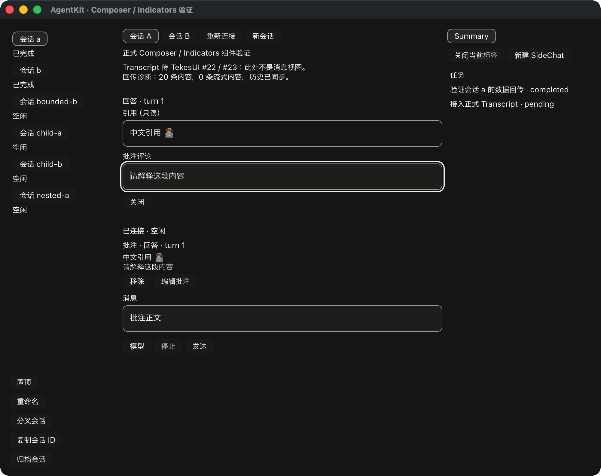

# 批注评论编辑与共享草稿

基线仍为已发布 AgentKit v0.3.8；本次 API 是 PR #10 未发布增量。
TekesUI 固定公开 `431093786de47b48cd566d0d9c0eafa088b10d68`，八个包、188 输入未变。
没有修改 Swift、Kernel、TekesUI 或另建 Run 状态机。

只读对照当前 ClientKit 的 ComposerCardView.setAnnotationComment、
ComposerAnnotationStore.updateComment 和 RunView 的评论回调，以及 Tekes 的宿主适配边界。
已有批注的评论在已提交编辑时同步到共享草稿，保留空白和换行；不把评论编辑改成新
消息或 Save/Enter 发送。撤销由 TekesUI 的 TextSurface 维护，不在共享 store 再记一套
每次敲键的 undo。组字期间不产生评论写入，也不允许导航或主 Composer 发送。

`AnnotationEditor` 是可独立挂载的 Agent 组件，组合公开 Stack/Text/Button/TextField。
引用预览使用只读多行字段，Grow 上限为三行；评论字段为六行。焦点、选区、复制、
组字、撤销与字段滚动均由原控件提供。组件不解析 prompt，不读取源文件；保存时仅
替换原 annotation.comment，保留 ID、excerpt、source 和 source_locator。DTO 验证不
代表来源已独立核实，没有生成“来源可用”状态或实现来源高亮。

接入顺序：

1. 从原 ComposerContext 的 EditAnnotation 意图打开组件；宿主保留原 RunBinding，
   检查其权威与当前 context capture。给组件保留独立 namespace，并在挂载后显式聚焦。
2. 每批事件后排出 AnnotationEditorIntent::Change，用原 binding.edit_annotation 写入。
   它沿用共享 patch_context 的版本/选择/生命周期检查，只更新评论，保留较新的正文、
   settings 和其他内容；失败不会换一个新 capture 自动重试。
3. 将返回的原 controller `Option<Arc<RunSnapshot>>` 交给 complete。确认保留字段
   实例、选区、marked text 与 undo，并同时推进 publication 屏障，拒绝晚到的旧快照。
   若等待期间又有输入，成功确认后再次 take_intents(&[]) 排出较新的已提交编辑。
4. 对原 controller 的后续快照调用 update_authority；权限或内容失效不替换输入框。
   None/错误使 capture 过期，保留本地文本供恢复，不自动重放；关闭后重新打开使用
   新 capture。宿主若异步处理评论，应在 is_pending 时限制业务提交，并先处理评论
   更新，再 prepare 主消息。demo 使用同步本地写入。

ComponentDemo 在卡片上显式启用编辑入口。组件闭合时保留但不挂载，没有空布局节点；
导航/Send 解除旧编辑器焦点，已提交评论留在原会话草稿。主会话、pane 来源与导航代数
始终保留原 binding；来源移除或权限变化只使旧 capture 失效，不重定向到新选中会话。
第二公开 consumer 只消费两个公开 UI 包，独立挂载并通过公开方法应用评论变化。

本地 UI 115 tests、strict all-targets Clippy、fmt、demo build、18 工具测试及依赖/实际
Cargo 输入检查通过。root 未改，没有重复上一阶段 root 105 tests。新增五项测试覆盖
组字、只读引用、原文/来源/正文/settings 保留、等待时的新输入、TekesUI undo、内容
ABA、权限失效、过长评论、旧 callback/ID、以及组件→共享编译→单次发送。

review 以失败测试复现“确认已写入后，旧 publication 又把编辑器误标为过期”，随后
将确认值从孤立 context 改为原 controller 的完整 snapshot，补齐 publication 屏障。
反例和通过记录保留。原生首轮脚本在多行编辑后复用旧关闭按钮坐标而未继续；改为
等待精确评论状态、重排后读取新 geometry，再关闭和发送，没有放宽内容或组字断言。

原生 `--components --annotation-selftest` 验证公开卡片入口、编辑、组字时的 Send/导航
屏障、共享草稿、编译、单次正文、流式结束及 A/B 隔离。原有 context 和完整原生回归
另行复验。三端 `--ui-components --ui-annotation-editor` 验证同一组件的编辑评论与
原始 source/excerpt DTO 保留，再经共享编译、规范化消息文本回传并结束；使用隔离
状态和本地合成 provider。该 fixture 的 source_locator 为 None，不冒充可验证来源。
离屏证明不是三端原生窗口、结构化历史卡片、物理 IME、VoiceOver 或性能验收。
分层结果见 [机器收据](rust-agent-ui-annotation-editor-20261020.json)。

仍需实际附件选择/上传/预览、选区生成批注及来源定位/高亮、内容移除 undo、其余
Composer 能力入口和创建结果对账 UI。正式 Transcript/RunView、混合 artifact 历史的
结构化恢复、完整 SidePanel、物理 IME 与阅读/分页锚点、最终 review/CI/合并/tag 未完成。
