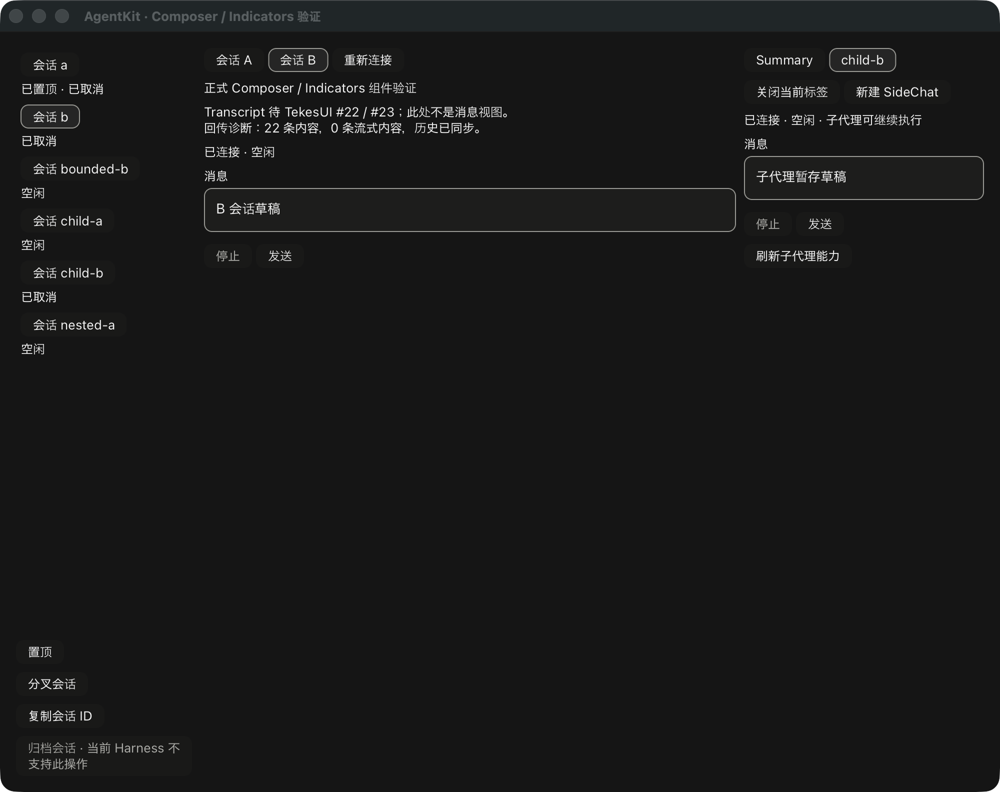
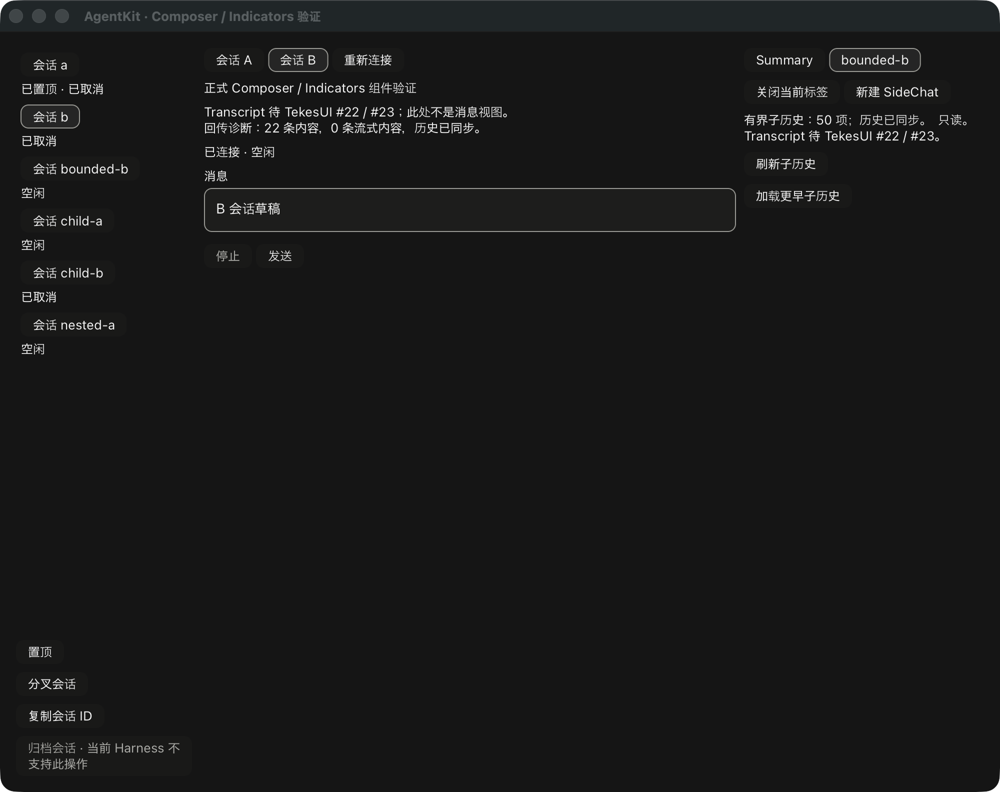

# 子代理 pane 接入记录

`ChildPaneBinding` 只连接既有 ChildRun / RunController 与 pane 生命周期。独立 session
提供自己的 Composer/Indicators；SameSession 有界历史通过公开 `subagents.history` 或
显式 ChildHistorySource 读取，始终没有 Composer，不把父会话历史当作子历史。
上图的有界内容只是加载诊断，不是正式 Transcript 或 RunView。

历史布局由宿主适配器注册，和控制能力分开。直接接收指令的 parent 可以是嵌套节点，
不等于窗口所选 root thread。SidePanelTab 新增 `child_parent` 作为内容来源身份；更换
直接 parent 或 layout 会淘汰旧安装 token。Typed source 防止主会话 binding 冒充子运行。
重复打开已缓存子代理时复用原 owner、控制器和草稿；退出 pane 撤销本地回调权限，
不取消或丢弃远端工作。

RunSnapshot 新增可选 `child_availability`，直接导出既有 catalog 策略的计算结果，
供 Indicators 显示能力未确认、continuable、one-shot、父代理不可用等限制。旧序列化
快照缺该字段时仍能读取；发送/取消仍由同一共享策略与 runtime 的即时 ownership 检查
决定。没有在组件中复制 catalog 或 Run 状态机。新增接口尚未发布，基线仍为 v0.3.7。

demo 接通 Summary OpenSubagent 的宿主回调，Native/Pi/DSH 的布局在 connector 注册时
明确提供。异步打开使用导航 token，迟到结果只缓存原 parent；过期错误不覆盖新选择。
每个 pane 只保留一个读取请求，initial/reconnect/已观察到的 parent 执行状态变化可合并
刷新；显式按钮负责重试，读取失败保留上次内容并显示错误。自定义 source 的分页属于
适配器，不因 `has_more_before` 就启用 endpoint 分页。详见 [公共绑定说明](../ui/bindings/README.md#child-pane-routing)。

只读对照 ClientKit 的 SessionChildHistoryLayouts、ChildComposerCatalogObserver、
RunChildHistoryObserver、ClientEmbeddedRunView 和 Tekes 的共享 host adapter；没有修改
Swift、Kernel 或 TekesUI。TekesUI 仍固定公开 `431093786de47b48cd566d0d9c0eafa088b10d68`。

本地 root 104、UI 83、工具 18 tests 通过，root/UI strict all-targets Clippy、fmt、依赖
边界与实际 Cargo 解析的 188 个 TekesUI 输入检查通过。新增测试覆盖嵌套接收 parent、
目录模式/父可用性/失败、旧快照兼容、只读内置分页、禁止父历史兜底、自定义分页边界、
单次读取和错误后显式重试、导航/组字屏障、草稿实例复用、owner 释放和父指针 token。
第二公开 consumer 消费 typed source 生成 tab。

原生 fixture 脚本验证独立子代理正文只提交一次、同回合 assistant 回传、interrupted
结束、未提交草稿及父草稿隔离；另验证有界只读 pane 没有 Composer、分页后加载数量
增加，以及关闭后旧 role 失效。第一次最终复验出现脚本未输入的 `ui hua` 文本并失败，
来源未核实；同一二进制重跑通过。失败没有算作通过。这些是合成文本服务验证，不是
物理中文输入法或 VoiceOver 验收。

真实 Kernel 0.9.1、Pi 1.3.0、DSH 0.2.1-rc.2 的协议、各自 child/有界历史与原组件到
GPU 路径复验通过，使用隔离 HOME/dataRoot 和本地合成 provider。三端离屏收据没有
打开新增子 pane，不能算真实三端子代理原生交互；[机器收据](rust-agent-ui-child-20261019.json)
明确保留该边界。

正式主/子 Transcript、RunView、完整能力入口/宿主动作、真实三端子 pane 原生操作、
物理 IME、阅读位置与分页锚点验收仍未完成。#22/#23 仍开放，PR #10 保持 draft，
完整目标通过后再 review/CI、合并与打阶段 tag。
