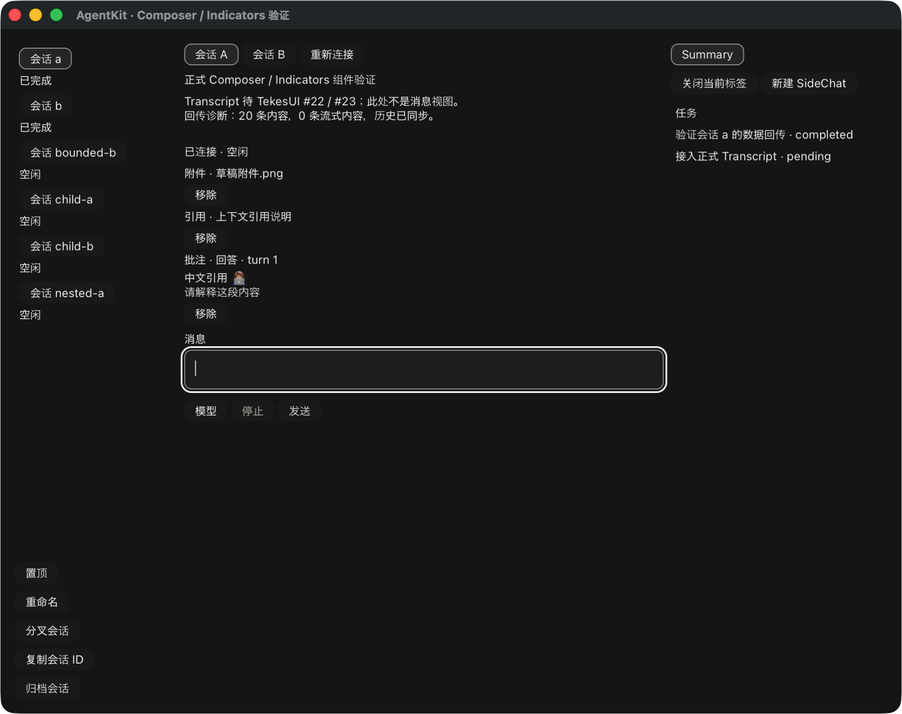

# Composer 草稿内容卡片与原子更新

基线为已发布 AgentKit v0.3.8；本次 ComposerContextBaseline/patch_context API 尚未
发布，属于 PR #10 的增量。TekesUI 仍固定公开
`431093786de47b48cd566d0d9c0eafa088b10d68`，八个包、188 输入未变。
没有修改 Swift、Kernel 或 TekesUI。

`ComposerContext` 组合公开 Stack/Text/Button，展示附件名称、命令、技能、引用与
批注。它可独立挂载，也可由 `Composer::with_context(namespace, labels)` 加入编辑器
上方。额外 namespace 必须由宿主明确保留；原 Composer 的八个 ID 不变。空草稿
不挂载卡片节点，不增加占位或间距；原编辑器、选区和 undo 实例继续保留。

正文、批注和附件是独立草稿字段。引用展示遵循共享编译器的 mention → path →
excerpt 优先级，不把未提交的预览 metadata 冒充模型会收到的引用文字。附件的
不透明 receipt/媒体数据不写入控件名称或卡片正文。相同内容在正文、settings 或
流式 publication 更新时保留行身份，卡片缓存与回调共享 Arc baseline，不给每个
按钮复制一份附件载荷。该检查不是性能或内存基准验收。

`ComposerContextBaseline::read(snapshot)` 捕获 destination、selection generation、上下文集合
与共享 presentation 的 `draft_context_revision`。已有 Run 的 model/settings gesture 不使
独立内容 capture 失效；NewThread 仍严格核对 selection generation，避免新草稿别名混用。版本按 destination 管理，只在内容
更改、Send、失败恢复或 materialize 时推进；正文/settings/流式 publication 不推进。
`RunController::patch_context` 在同一锁内核对 capture，只替换 artifacts/annotations，
保留最新正文和 settings。过期 capture 返回 false，不自动重试；移除后重新加入相同
DTO、空上下文 Send 和失败恢复均不会复活旧 callback。新字段缺失的旧序列化快照
仍按 0 读取；Rust struct literal 调用方需补充新增字段。`RunBinding` 另核对原 destination 和 task/child/SideChat 生命周期。
内容版本由共享 presentation 拥有，组件只消费，不增加另一套 Run 状态机。

组件发出带原 baseline/item 的移除、预览、来源定位与编辑意图。预览和编辑默认
关闭，只能由明确宿主能力开启；宿主必须解析原捕获值并验证权限/来源，不能查找
当前新选中的会话来重定向。批注的 excerpt/comment/source_locator 保留原 DTO，
不在组件中解析 prompt 或伪造来源已验证。正文组字期间，嵌入卡片的所有按钮均
禁用；demo 的外部指针和 AX 入口仍沿用整体组字屏障。

只读对照 ClientKit 的 ComposerCardView 移除/来源 callback、ComposerAnnotation、
ComposerArtifactSelectionReference，以及 Tekes 的 ClientAgentHostAdapters。
本地 root 105、UI 100、工具 18 tests、root/UI strict all-targets Clippy、fmt、demo build、
依赖边界与实际 Cargo 输入检查通过。第二公开 consumer 只依赖两个公开 UI 包。
新增测试覆盖原子保留正文/settings、内容 ABA、Send/失败恢复/选择失效、退役子代理、卡片
身份与载荷复用、旧 AX callback、组字和 destination 隔离。

原生 fixture 验证空起始文本、组字期间点击移除无效、提交组字后移除、共享编译、
单次正文、流式结束及切换会话时内容隔离。只用于显示的附件 receipt 在发送前被
移除，未声称上传或文件可用。原有完整原生回归另覆盖 Sidebar/Summary、任务、
SideChat、独立子代理、有界历史分页、发送/取消/重连。

真实 Kernel 0.9.1、Pi 1.3.0、DSH 0.2.1-rc.2 在隔离状态与本地合成 provider 下通过：
挂载卡片 → 显式移除 → 引用/批注经共享编译提交 → 在规范化用户消息文本中回传 →
assistant 结束与草稿清除。三端是离屏组件/数据证明，最终 GPU 图发生在结算后；
不是三端原生卡片像素、物理 IME 或结构化历史 Transcript 的验收。

review 先以失败测试复现“移除后重新加入相同 DTO，旧 callback 仍通过值比较”，
随后用共享内容版本修复，保留反例和通过记录。

原生复验曾分别出现 text=None 和脚本未输入的前缀 `2`，均判失败，来源未核实。
保留日志后，在测试初始化中加入清空/空值断言与焦点日志，再独立复验通过；没有
过滤意外事件、放宽组字断言或修改产品输入行为。详见 [机器收据](rust-agent-ui-context-20261020.json)。

尚未支持：实际文件选择/上传/预览适配器、批注编辑器与来源高亮、内容移除 undo、
预设和其余 Composer 能力入口，以及历史中的结构化内容恢复。正式 Transcript /
RunView、完整 SidePanel 内容、物理 IME/阅读锚点和最终 review/CI/合并/tag 仍未完成。
