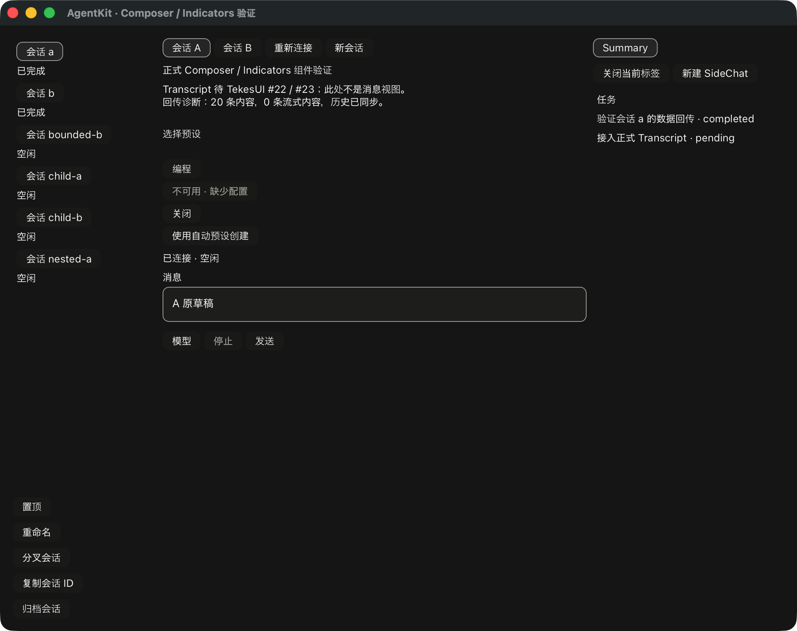

# 交互式新会话与初始预设

基线 AgentKit v0.3.8；正式 TekesUI pin 仍为公开
`431093786de47b48cd566d0d9c0eafa088b10d68`。本次为 PR #10 增量，未发布。

ComponentDemo 的“新会话”打开公开 ComposerChoices 预设面板，另提供显式“使用自动预设
创建”。不在加载时自动选择第一项；自动创建不携带 agent_preset。已有会话的预设保留。
面板是 AgentKit 的组合，按钮、焦点、组字和布局仍由 TekesUI 提供。

宿主提供绝对 cwd、可选 workspace 与独立 RPC prefix。隔离 fixture 使用 /fixture；
真实 endpoint 窗口需显式 `--create-cwd ABSOLUTE_PATH`，不从本机目录或远程 HOME 推测。
目录读取/创建期间，现有 Composer 仍属于原会话。收到创建确认后才打开新会话的正常
RunBinding/Composer；不是先把原草稿迁入一个尚未确认的目标。

`InitialSessionCreation` 捕获选项、创建参数、原 endpoint、session ID 和 RPC ID。
缺省 session ID 在捕获时通过 UUID 生成，执行时不再生成。选择项创建前重新读取公开
目录；自动模式直接保留 Harness 自动行为。执行使用既有 SessionRuntime::create，
校验返回的 session 身份；随后普通 RunBinding 使用原 controller 流程发送/取消。
第二 public consumer 可通过原 RunBinding.create_initial_session 调用，不导入内部 runtime。

所有异步结果保留原 request 和导航代数。晚目录/错误不重开已关闭面板；晚创建可出现在
共享 inventory，但不会抢走新导航或正在组字的 Composer。创建 pending 期间禁用目录行、
自动创建和新会话按钮；关闭仍可用。失败/不确定结果保留原捕获动作和 pending 屏障，
不通过再次点击悄悄创建替代会话。demo 尚无专用创建结果对账/重试 UI；宿主可用公开的
session_id/rpc_id 进行明确恢复，不能换 ID 自动重发。

本地 UI 109 tests、strict all-targets Clippy、fmt、demo build、18 工具测试及依赖/实际
Cargo 输入检查通过；root 未改，没有重复上一增量 root 105 tests。新增四项测试覆盖
公开选择→创建→正常发送、自动创建与相同捕获重复执行、原草稿、晚导航/错误、组字及
不确定结果后的重复点击屏障。uuid 仅用于捕获创建身份；边界检查仍禁止 bindings 引入
平台、渲染器和 harness adapter。锁文件只增加 bindings 对已锁定 uuid 的依赖。

`--components --creation-selftest` 验证原生预设面板、创建、正常 Composer、中文组字时
点击 Send 无效、单次发送/流式结束与原 A 草稿保留。完整原生回归再次通过 Sidebar、
Summary、任务、SideChat、独立子代理、有界历史及发送/取消/重连。这些使用合成文本服务，
不是物理中文输入法、VoiceOver 或正式 Transcript 的验收。

三端 `--ui-components --ui-initial-presets` 现走同一个 ComponentDemo 新会话入口、公开
AX 选择和正常 Composer Send，而非独立脚本专用面板。隔离状态/本地合成 provider 下，
Native coding、DSH standard 与 Pi default 创建、配置模型、单次发送、流式结算、原草稿
保留均通过。Native summary/DSH agentPreset 投影返回身份；Pi 无独立身份字段。
离屏证明不算三个 harness 的原生窗口验收。详见 [机器收据](rust-agent-ui-creation-20261020.json)。

仍需实际文件选择/上传/预览、批注编辑与来源高亮、内容 undo、其余 Composer 能力入口；
正式 Transcript/RunView、完整 SidePanel、物理 IME、阅读/分页锚点和最终 review/CI/合并/tag
尚未完成。新 #23 公开输入的复验与交付缺口单独记录，当前没有升级正式 pin。
