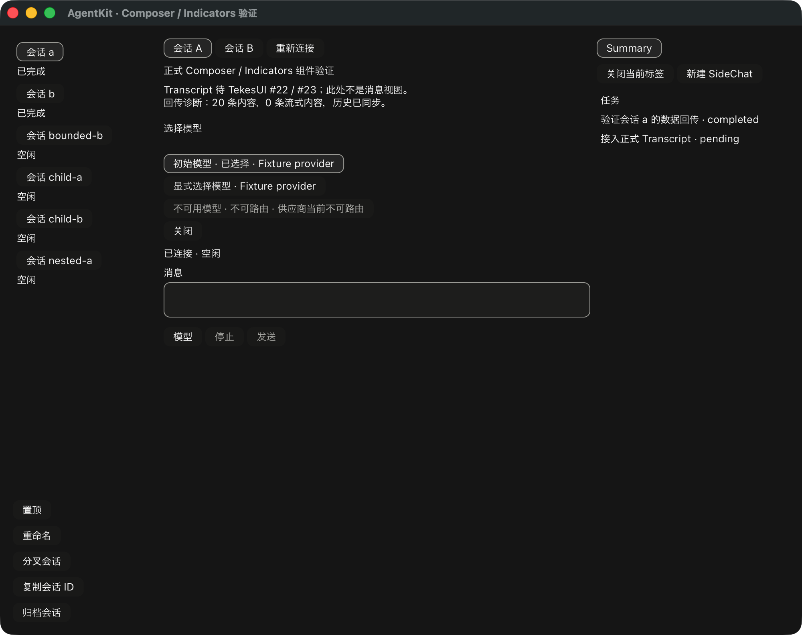

# Composer 模型目录与发送前配置闭环

模型入口现已连接 ComponentDemo 与公共 `session.models`。基线仍为已发布
AgentKit v0.3.8，TekesUI 固定 `431093786de47b48cd566d0d9c0eafa088b10d68`，
八个包、188 输入不变。没有修改 Swift、Kernel、TekesUI 或另写 Run 状态机。

`ModelChoices` 保留原目录、扩展和 failures；界面身份按 provider/model JSON framing，
不会按冒号拆解。新目录按 routableProviders 限制；Kernel 0.9 的基础 SessionModels
没有该可选扩展，其 groups 是已配置的 enabled 模型，并通过 failures 明确报告
provider 不可用。消费侧兼容这套基础契约；缺失路由事实则禁用，不推测安装/认证。
只读对照 ClientKit 的 SessionModels、ComposerModelCatalogRead、模型选择命令，
Tekes 的 ClientAgentHostAdapters，以及 Kernel model_projection 源码。

选择面板由 AgentKit 的 ComposerChoices 组成，编辑、焦点、按钮和布局使用 TekesUI。
界面捕获原 binding/destination/request 与主导航、pane 导航代数，过期目录和错误
不重新打开已切走的面板。关闭释放未提交的 settings request；源撤销、只读或
组字期间不会授予写权限。目录失败可见，没有逐帧重读或自动重试循环。

选择只修改共享 draft settings，模型按钮明确标注“发送时应用”。默认示例宿主
显式采用 ModelSelectionPreparation，只支持 `modelSelection: {provider, model, reasoningEffort?}`；
重新选择当前模型时保留其显式 reasoningEffort，不额外展示尚未接入的推理开关。
发送前重新核对目录、按 PreparedSubmission 身份调用 session.selectModel、验证
回执，再交还现有 controller 提交正文。配置失败不提交正文并保留草稿；其他设置
需要显式宿主适配器，不能被静默忽略。provider-specific reasoning/fast/thinking
开关与预设配置仍未接入。

本地 UI workspace 95 tests、strict all-targets Clippy、fmt、demo build、工具 18 tests、
依赖边界和实际 Cargo 输入检查通过。新增测试覆盖新/旧目录、重复 identity、未知
当前值、不可路由 provider、导航后晚成功/错误、配置发生在唯一正文之前，以及
配置失败不发送且恢复草稿。第二公开 consumer 仍只依赖两个公开 UI 包。

`--components --model-choices-selftest` 的原生 fixture 验证目录展示、禁用项、选择、
共享 settings、发送前配置恰好一次、正文恰好一次、流式结束和另一会话的隔离。
原有完整原生脚本另通过 Composer/Indicators、Sidebar/Summary、任务、SideChat、
独立子代理和有界历史分页回归。它们是合成文本服务验证，不是物理输入法验收。

真实 Kernel 0.9.1、Pi 1.3.0、DSH 0.2.1-rc.2 用隔离 HOME/dataRoot 与本地合成 provider，
各自通过公开目录 → 显式选择 → 模型配置回执 → 正文提交 → assistant 结束 → GPU。
测试刻意对现有 synthetic 模型做显式选择，不声称跨 provider 切换或收费模型质量。
`--ui-model-choices` 的选择由测试脚本显式触发，组件不会自动选择第一项。

首轮 Pi/DSH 通过而 Native 因消费侧要求可选 routableProviders 失败；根据基础契约
修正并增加回归后，三端复验通过。首轮失败保留在机器收据，不算通过项。
离屏结果不算三端原生交互，截图也不是标准 RunView 或正式 Transcript。
详细日志 hash 和分层结果见 [机器收据](rust-agent-ui-model-integration-20261019.json)。

仍需预设/附件/批注和剩余能力入口、正式 Transcript/RunView、完整 SidePanel 内容、
真实三端原生操作及物理 IME/阅读锚点验收。TekesUI #22/#23 仍开放；PR #10 保持 draft。
