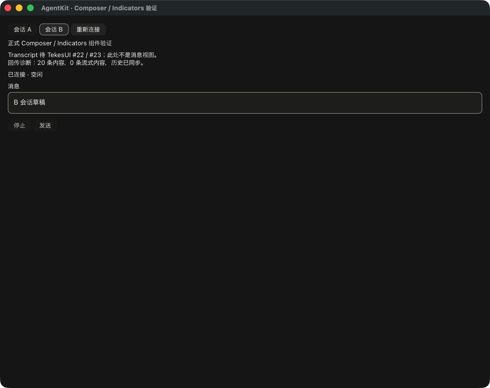

# Composer / Indicators 原生接入记录

这是正式 `Composer`、`Indicators` 和 `RunBinding` 的局部接入验证，不是完整 RunView 或 Transcript 的交付。界面中明确显示 Transcript 的上游阻塞；没有用纯文本消息框顶替多块消息布局。`ComponentDemo` 是 demo 宿主布局，不是新的标准 Agent 组件。



## 依赖与运行

AgentKit 已发布基线仍为 v0.3.7 (`a8610a420bad72eaedcf706b30df87153a0f3e16`)。UI 开发包保持 `0.0.0` / `publish=false`。TekesUI 使用公开完整 revision `431093786de47b48cd566d0d9c0eafa088b10d68`，8 个解析 package / 188 个输入文件保持原固定校验值，没有消费兄弟 worktree。

```sh
cargo +1.95.0 build --manifest-path ui/Cargo.toml --locked -p tekes-agent-ui-demo
ui/target/debug/tekes-agent-ui-demo --components
ui/target/debug/tekes-agent-ui-demo --components --native-selftest
ui/target/debug/tekes-agent-ui-demo --components --offscreen /tmp/agent-components.png
```

真实 harness 仍使用原显式 `--endpoint-config /absolute/config.json`；可与 `--components` 组合。模型、凭证、路径和会话由宿主显式提供。原生 selftest 只使用本地 fixture，不允许接真实配置。

不传 `--components` 时保留原 `RunSurface` 协议/控件测试路径。这两个 demo 路径都不是标准 RunView。

## 所有权与时序

- `ComponentDemo` 只拥有宿主导航、整体布局、组件挂载和回调路由。每个会话保留自己的 Composer/Indicators Content 实例和绑定；切换只移出/放回原实例，不复制草稿或提交状态。
- Composer 意图立即排空。发送先同步调用 `RunBinding::prepare_send`，应用共享 presentation 的受控清空，再启动异步 `dispatch_prepared_with`。后续输入属于新草稿，回调继续绑定原 session 与 ticket。
- 宿主放弃尚未 dispatch 的 ticket 时调用 `cancel_prepared`，通过共享 controller 恢复草稿；不会自动重发。模型/预设等设置仍需显式 `SubmissionPreparation`。
- 两个源的既有订阅通过公开 WindowWake 唤醒窗口，不按帧轮询。后台源收到结算/重连更新不会改写当前编辑器。
- 窗口失活时取消输入交互并暂存焦点目标，激活后经公开 ContentHost 验证恢复；编辑、组字、文本几何、选区和焦点机制仍由 TekesUI 实现。原测试宿主与新窗口共用公开平台事件、文本/AX 发布和字体渲染适配。
- 发送按钮的内容有效性复用共享 `ComposerDraft::compile`；空白草稿不可发送，纯附件不会被简单的“文本为空”判断误挡。controller 在 admission 时仍复核真实 capability。

## 已验证范围

| 证据 | 证明的范围 | 不证明的范围 |
|---|---|---|
| 原生窗口脚本通过 `NATIVE_AGENT_COMPONENTS_SELFTEST_OK` | 实际 Cocoa/Metal 窗口挂载 Composer/Indicators；合成 preedit 期间点击发送不提交；受控清空、发送、流式状态、取消、A/B 草稿隔离、重连 | 物理中文输入法、VoiceOver、正式 Transcript、分页锚点与完整 RunView |
| 组件测试 | 组字/会话切换屏障；保留同一 Composer 的选区；同步冻结提交后继续输入不串入旧请求；异步结果不改投新会话；重连不重复消息；本地取消 preparation 后显式重试 | 原生输入设备与最终视觉验收 |
| 三个真实 harness + `--ui-components` | Kernel 0.9.1、Pi 1.3.0、DSH 0.2.1-rc.2 的数据恢复进入绑定，并渲染实际 Composer/Indicators；本地合成 provider、隔离 HOME/dataRoot | 真实付费模型质量、三端完整原生交互、Transcript 内容渲染 |
| 第二 public API consumer | 公共 Composer/Indicators/Sidebar/SidePanel/Summary 组合继续通过，绑定 API 编译通过 | 完整 RunView 的第二宿主接入 |

三端脚本的运行方式与原来相同，额外传入 `--ui-components`：

```sh
python3 scripts/test-real-session-endpoints.py \
  --kernel-root /absolute/kernel-source \
  --kernel-target-dir /absolute/kernel-target \
  --pi-root /absolute/pi-runtime --dsh-root /absolute/dsh-runtime \
  --ui-demo "$PWD/ui/target/debug/tekes-agent-ui-demo" \
  --ui-components --ui-output /tmp/agent-components-native.png
```

输出分别为 `NATIVE_UI_COMPONENTS_LIVE_OK`、`PI_UI_COMPONENTS_LIVE_OK`、`DSH_UI_COMPONENTS_LIVE_OK`，明确带 `transcript-view=false; native-interaction=false`。原生窗口脚本的合成文本服务证据独立于这三个离屏证据。

TekesUI #22/#23 在本轮检查时仍开放，尚无新 API 交接。后续仍需正式多块 Transcript、RunView、各 SidePanel Run 内容、完整宿主对接和物理 IME/阅读/分页验收，再进行交付 review、远程 CI、合并与阶段 tag。机器收据见 [验证范围](rust-agent-ui-native-controls-20261019.json)。

本轮本地 gate：root 104、UI 66（含第二公开 consumer 4）、工具 18 tests；root/UI strict all-targets Clippy、fmt、依赖边界和 Cargo 实际解析输入检查通过。这些本地结果尚未提交触发远程 CI。
