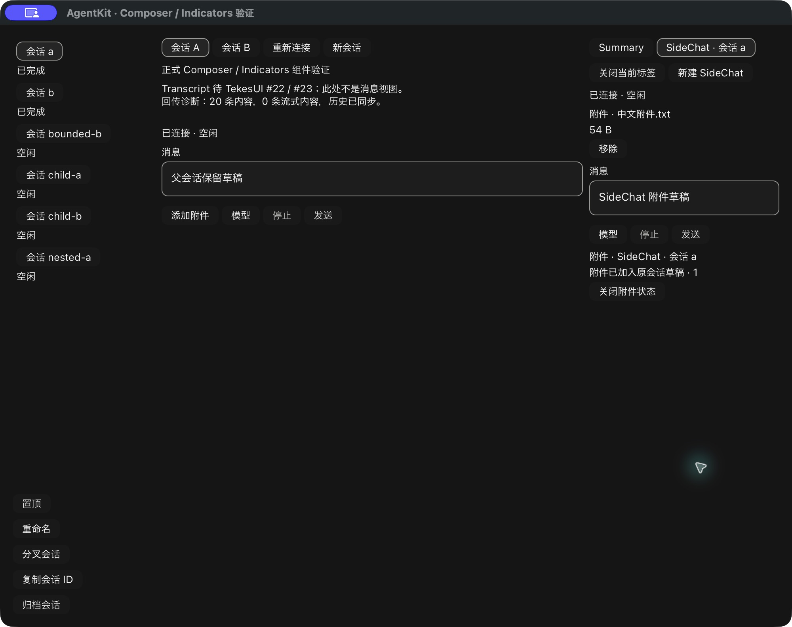
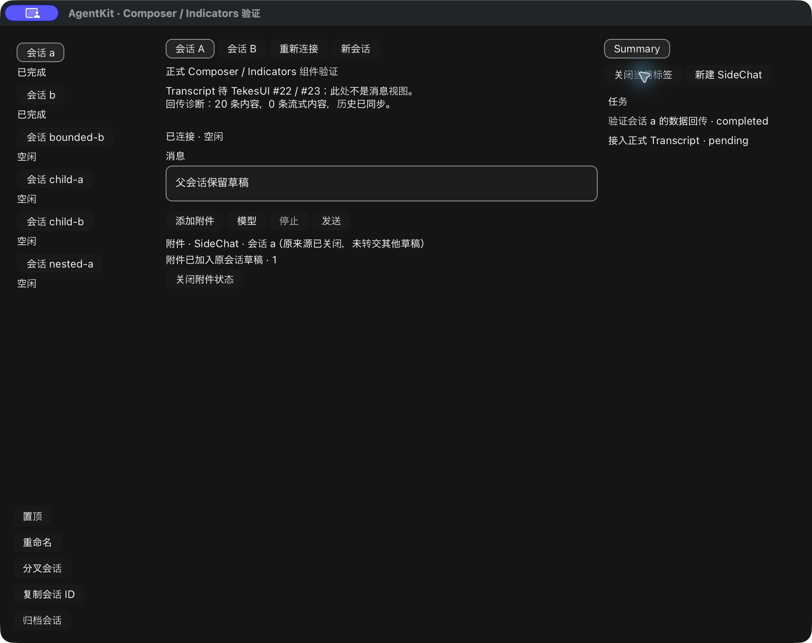

# SidePanel 的附件入口和原来源状态保留

最新发布基线仍为 AgentKit v0.3.8；本轮新增 UI 接入未发布。TekesUI 仍固定公开 `431093786de47b48cd566d0d9c0eafa088b10d68`，未修改上游、Kernel 或 ClientKit，也没有 Swift 源码/工具链。

## 行为与所有权

任务、独立子代理和 SideChat 的 Composer 现在复用 Main 的系统文件选择命令、公开 AttachmentSelection、canonical content/epoch CAS 与 ComposerUploads。上传只限制原 binding 的 Send/entries，父运行及其他来源保留原 gate。共享 binding 读取已有 `RunSnapshot.can_submit`，避免向 one-shot 或尚未恢复的来源提供上传；宿主仍遵循现有 child-read 和 IME 屏障。有界同会话子历史没有 Composer，也没有附件入口。

操作记录改为 request ID＋原 Arc<RunBinding>。同地址的任务替换、任务与父运行的独立 controller 不会共享 request、draft 或回执。address-only report 查询遇到歧义返回 None；request 查询保留精确身份。没有依赖标题/标签推断目标。

状态内容放在宿主公开 Stack slot，独立于会缓存、替换或关闭的 pane body。切标签时保留同一状态实例与 IDs；返回时恢复。来源关闭/撤销/归档后，记录进入明确标注原来源已关闭的保留区，保持已知回执和原文件字节，晚回执不写父草稿、不接到同地址的新 controller、不抢导航/焦点。只有终态 Dismiss 才释放本地操作记录，不自动删除远端文件。新操作分配新 namespace；宿主 wrapper 与 Kit status 使用不同 namespace。

这是宿主内容挂载、系统适配和 handle 保留，上传事实仍由 Kit binding 发布，草稿与权限仍由原 presentation/controller 拥有；没有引入另一套 Run 或控制器状态机。所有组件/布局能力使用固定 TekesUI 公开 API，本轮没有需要绕过的基础控件缺口。

## 组件/SEP fixture 用例

新增 7 项必要边界用例：

- SideChat 上传只 gate 自身，父 Send 可用；切 A/B 后晚完成仍归原 SideChat，返回恢复状态及正确 Send ticket。
- 暂停上传期间关闭 SideChat，恢复回执后为 Detached；已知 receipt 留在独立保留区，父草稿无附件。
- 同地址任务换源期间旧上传返回，旧回执与新 binding 的成功操作各自保留。
- 同地址 Main 与 Task 能各自捕获上传，pending/附件不交叉。
- 独立子代理上传到自身；有界子历史无 picker。
- 子代理 refresh 与中文 preedit 均不能打开 picker 或误发送。
- 独立 one-shot 子代理按 canonical admission 禁止上传，不发生 upload RPC。

fixture 使用真实公开 SessionRuntime/SEP 调用及受控上传 gate，不读私有文件。它证明来源生命周期与组件绑定，不能等同于实际三个 harness 的所有 pane。

## 实际原生窗口证据

使用本轮构建的 Rust demo 二进制，在独立临时 app、本地合成 SEP fixture 和真实 macOS 选择器上完成：创建 SideChat，分别填入父/SideChat 正文，选择拥有的 54 字节中文文件；文件卡片及状态只出现在 SideChat，父草稿保留。切到 Summary 时隐藏，返回 SideChat 时恢复。关闭 SideChat 后，状态以原来源已关闭的标记保留在宿主区域；父草稿没有文件。显式 Dismiss 后，又创建第二个 SideChat，通过同一真实选择器选文件并点击其 Composer Send，观察其执行中/结算、正文及附件清空，父运行保持空闲且父草稿未变。

原生 AX 文本见 [记录](rust-agent-ui-pane-uploads-native-20261020.txt)。初次后台索引点击和批量 AX SetValue 未产生所需变化；依据实际截图定位、聚焦后粘贴以及后续单个聚焦字段 SetValue 才完成输入。没有更改产品过滤或放松断言；中文输入证据是粘贴/AX/合成 preedit，不是物理 IME/VoiceOver。

该窗口上的关闭发生在上传完成后；上传中关闭的晚回执情况由前述带 gate 的 fixture 用例证明，不能把两种证据合并称原生竞态验收。它也没有正式 Transcript，SideChat 的消息正文视图仍未交付。

## 回归与剩余项

完整 UI/第二 consumer、严格 Clippy/fmt、边界与实际 188 输入校验、工具检查见 [JSON 收据](rust-agent-ui-pane-uploads-20261020.json)。五项既有原生回归通过；真实 Kernel 0.9.1 / Pi 1.3.0 / DSH 0.2.1-rc.2 的 Main 附件（含纯附件）→Send→新连接 journal 数据路径亦复验。这个三端 Main 回归不证明三端 pane 附件/原生交互都已验收。

仍需真实三端 pane 联调、可用来源的预览、专用失败/未知结果和持久化对账、内联图片、物理 IME、正式 Transcript/RunView 与阅读/分页锚点。DSH 仍无通用文件下载。PR #10 保持草稿，不合并、不打 tag。
