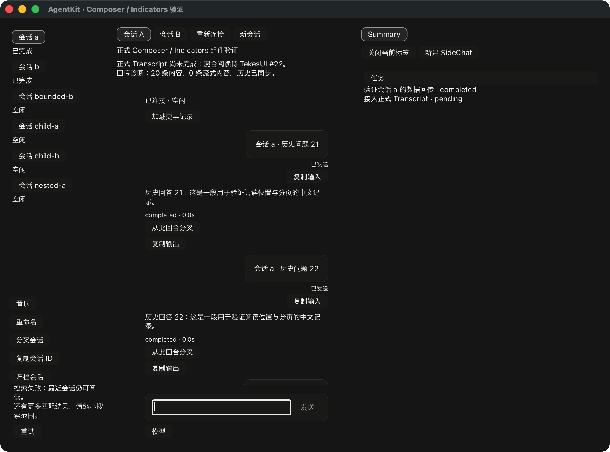

# Sidebar 搜索 footer 的布局与显示输入

本记录属于 footer 阶段；后续[单端共享 reader 与公开 RPC](rust-agent-ui-sidebar-query-controller-20261021.md)已继续推进，旧收据仍保持其原始范围。

本轮只读对照当前 ClientKit `ClientAgentSidebarListView.swift` 的 `observe()` / `layout()`、`ClientAgentSidebarModel.swift` 的搜索来源与状态、`SessionSearch.swift`，以及 Tekes 的 `ClientAgentSidebarHostAdapter.swift`。源码哈希见同名 JSON。Rust UI 保持实验状态，尚未完整对齐 Sidebar。

## 对应 View 的已接入规则

Sidebar 直接拥有搜索 footer，独立于 inventory 的首次恢复、观察失败及共享行操作。显示来自明确的 `SidebarSearchInput`，与 inventory publication 分开：

| 输入 phase | 显示 |
| --- | --- |
| Idle / 清空搜索 | 不占布局、输入或 AX 槽位 |
| Searching | 搜索中提示，无 Retry |
| Complete + has_more | 提示还有更多匹配，请缩小搜索范围 |
| Complete + 无更多提示 | 隐藏 footer，不据此推断搜索列表为空或协议已穷尽 |
| Failed | 显示错误；has_more 为真时在错误后追加更多提示；只有 retryable 明确为真才提供 Retry |

源 View 在列表外底部放置 footer：左右和底部采用 TekesUI `Spacing::Regular`，不增加源中不存在的顶部间距。正文区域让出 footer 的实际首选高度。错误很长、首选高度大于 pane 时，按源规则仍将 footer 底部锚在 pane 底部，列表区域降为零，高出的顶部由真实 ancestor clip 裁剪；不会把 Retry 排在窗口底部之外。正文子树使用正文区域与 pane 的真实交集作为 clip，零高度时不能画到或命中 footer。原列表 ScrollContent、行控件和其 authority 不因 footer 更新重建。

当前共享动作面板仍是早期实验组合，尚未替换为 ClientKit outline 的行内菜单；这里的“正文区域”包括它。本文不把整个 Sidebar 的 outline/status-pane 排版或视觉标为通过。普通文字、按钮、聚焦、事件、裁剪和滚动继续消费固定公开 TekesUI，未添加自己的皮肤或通用控件状态机。

## 公开 API

- `SidebarSearchKey` 捕获 source owner、endpoint、connection_epoch、generation 和完整 query。owner 对应一个搜索数据源生命周期；同一来源的 generation 单调且不得复用，包括 query A → B → A。
- `SidebarSearchInput { revision, key, phase }` 是独立的单调显示发布；`key=None + Idle` 表示清空。`Sidebar::update_search()` 验证源身份、版本和代数后原子替换；旧版本、同版本冲突、被清空/淘汰的尝试不会重新显示。搜索代数在清空后仍被记住。
- `SidebarSearchLabels` 经 `set_search_labels()` 接收产品文案；基础样式来自 TekesUI 默认组件和 tokens。
- `Sidebar::take_search_intents()` 返回单独的 `SidebarSearchIntent::Retry { key }`。接收方必须回到原数据源并在 IO 前重新核对 owner、endpoint、epoch 和 generation；该回调不授予远程调用权限。`set_search_retry_pending()` 只可限制当前 Retry，不可启用源未提供的动作。
- 同一个可重试失败的普通刷新保留原按钮；阶段/来源改变后不复用已退休 action ID。已 drain 的旧原始动作同样不能被解析到新查询。
- `search_footer_id()`、`inventory_region_id()`、`inventory_viewport_id()` 提供实际挂载节点身份，方便宿主/测试在排版后检查真实 frame；不提供业务侧像素滚动补偿。

`ComponentDemo::set_sidebar_search()` 仅供明确输入接入。普通 demo action 路径产生 `DemoCommand::SidebarSearch`，不会把它误路由为会话选择、mutation 或 Composer 发送。默认 demo **尚未安装跨端搜索数据源**，不会自行搜索、扫会话或暗中调用模型；若额外宿主安装 footer，却未接数据源，会得到明确未安装错误。

## 验证与证据边界

组件测试覆盖各 phase、能力限制、独立 inventory 版本、pending、原按钮保留、旧原始手势、同版本冲突、query/epoch ABA 与清空后旧尝试淘汰。CoreText 的 16 组组合覆盖两种宽度、四档字号倍率、浅深色与长错误，检查真实 footer/Retry frame、底部可见性和收起后的空间恢复。另有普通 ComponentDemo callback 路由与草稿不变测试；第二公开 consumer 只消费公开 DTO、Component 和回调。

`--components --transcript-content --sidebar-search-selftest` 使用 owned UI publication，真实鼠标 Retry 经 ComponentDemo 路径回到原 key，然后显示 searching/more/完成/清空/再次失败，核对原 inventory 行保留和无 submission。这个探针**没有搜索 RPC、没有真实 harness outage，不证明搜索结果查询、列表成员关系或跨端聚合通过**。原生截图若接受，仅证明该实验 fixture 的 footer 状态，仍没有配对 ClientKit 视觉证据。验收收据见同名 JSON。

## 仍需完成的 AgentKit 工作

搜索查询控制器、250ms 去抖、跨 endpoint 的真实能力和结果聚合、连接代数/取消隔离、未知 inventory 命中后的公开刷新、snippet/help 与结果成员/排名、搜索 header/count、分组及完整 outline/status-pane 对齐仍由 AgentKit 完成。三端结果 schema 和截断语义也需逐项对照：当前 Pi 扩展的 `session.search` 返回至多 20 个 items，未提供 hasMore，不能在接入时直接把缺省值当作已穷尽的证明。该结果层尚未接入此 footer，本轮未改变 adapter。不得将这些共享业务规则要求每个宿主各自实现。当前增加的是同名 View 的 footer 显示与原来源回调部分，**不是把上述完整搜索功能替换成宿主状态机**。

默认 TekesUI 保持精确公开 `8cf0840790334ba224afc0595897c74231c712e6`；未修改或升级冻结候选，未关闭相关上游 Issue。
