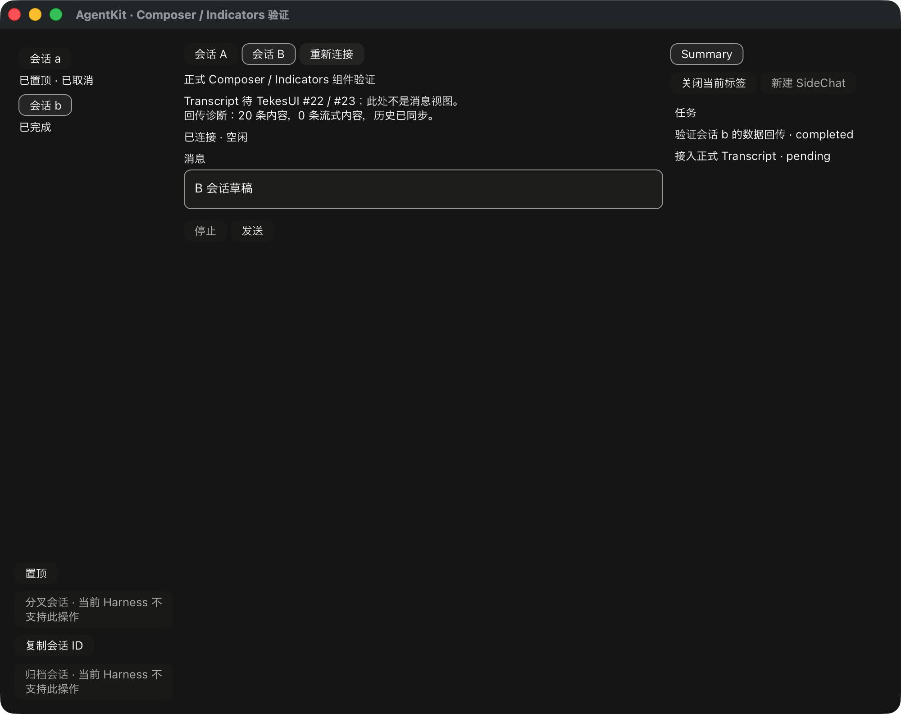

# Sidebar / Summary 宿主接入记录



本轮把实际 `Sidebar`、`SidePanel`、`SummaryView` 接入 `--components` 窗口。中心仍明确标记 Transcript 未实现；这是组件接入窗口，不是标准 RunView 或最终视觉验收。Composer 编辑框也不是 Transcript 的 input 气泡。

## 接入与所有权

`SidebarBinding` 消费既有 `SharedAgent` 的列表、活动、置顶和动作定义，和 RunBinding 使用同一个 runtime。配置通过 `into_connector` 一次交给共享 registry，避免创建第二个 Pi connector。UI 不维护置顶数据库或重新推导动作策略。调用方式见 [绑定说明](../ui/bindings/README.md)。

菜单动作保留地址与 RPC 身份，由共享 dispatcher 复核；复制重新读取共享 copy value。选择已缓存会话时恢复原组件，选择其他 inventory 行时异步取得自己的历史 lease。较新的选择、组字和 pointer 消失会淘汰迟到结果；pointer 返回也不会复活旧回调。

Summary 使用当前 RunSnapshot 的 SummaryFacts。fixture 的任务来自真实进入投影的 `todo/write` journal 事件，没有在 widget 中编造任务状态。A/B 切换保留各自 Summary 内容，任务、子代理、产物动作仍是带原作用域的 host 回调。

只读对照当前 `ClientAgentSidebarModel.setPinned`、Tekes 的 `ClientAgentSidebarHostAdapter` 和 `ClientAgentSummaryHostAdapter`：置顶写入共享 authority，产品 URL scheme、导航和应用扩展由 host 提供。本轮没有修改这些 Swift 仓库。

## 共享服务修正

发现并修正了自定义 `ThreadActionHost` 的一个不一致：菜单使用 `pin_state`，列表却只读内置 preferences 的 pins，导致自定义 adapter 的徽标缺失。现在列表和菜单读取同一 authority，host mutation 后通知订阅者；外部 adapter 可显式 `invalidate_thread_inventory`。

回归测试先确认旧实现返回 null 徽标，再验证修正后初始徽标、取消置顶后的主动更新和外部 invalidation；全过程没有 Harness RPC。该修正仍在工作分支，尚未发布；已发布基线仍为 AgentKit v0.3.7。

## 运行与验证范围

原命令 `--components` / `--native-selftest` / `--offscreen` / `--endpoint-config` 继续适用。fixture 使用本次运行独占的临时 preferences 目录；真实 endpoint 默认不安装置顶存储，宿主可显式指定：

```sh
ui/target/debug/tekes-agent-ui-demo --components \
  --endpoint-config /absolute/endpoint.json \
  --thread-preferences /absolute/owned/thread-preferences.json
```

`--thread-preferences` 必须是绝对路径；它使用共享 store 的 scope/锁/重放，不创建 UI 副本。产品 host 应自行选择身份范围和存储位置。原生窗口目前执行会话选择、pin/unpin 和复制；重命名、分叉、归档的交互尚未接入，会在发送 RPC 前明确拒绝，不伪装执行成功。

原生脚本已验证实际 Sidebar 选择、共享置顶广播、Summary 的当前父会话数据，以及原有组字屏障、发送/取消、草稿隔离和重连。合成文本服务不等于物理输入法或 VoiceOver 验收。

Kernel 0.9.1（Native SEP）、Pi 1.3.0、DSH 0.2.1-rc.2 的真实 SEP 验证均通过；离屏收据明确检查 inventory 非空、同一 runtime、Sidebar/Summary 已挂载、历史恢复且有 final assistant。使用隔离 HOME/dataRoot 与本地合成 provider，不是三端完整原生交互验收。本机旧 DSH cache 目录被移除后，用已有 installer 在忽略的测试目录恢复精确版本，并记录新的 package-lock hash；没有改原安装或提交 runtime 文件。

TekesUI 仍固定公开 revision `431093786de47b48cd566d0d9c0eafa088b10d68`（188 输入文件）。#22/#23 仍开放。正式 Transcript/RunView、任务/子代理/SideChat 的 Run 内容、其余宿主交互和物理 IME/阅读/分页验收仍未完成。完整交付目标不变。

本地结果为 root 104、UI 69、工具 18 tests，以及 root/UI strict all-targets Clippy、fmt 与实际依赖输入检查通过。[机器收据](rust-agent-ui-sidebar-summary-20261019.json) 记录的是本地与局部原生证据，尚非远程 CI 或完整交付通过。
