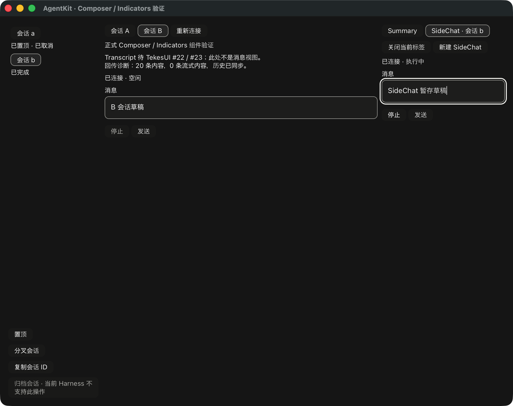

# SideChat 组件接入记录

本轮在现有公开 `SidePanel` 中挂载独立的 Composer / Indicators，复用原有
`SideChatController` 和 `RunBinding`。这不是完整 SideChat RunView：正式 Transcript
仍需 TekesUI #22/#23 的公共基础能力，截图也不是最终视觉验收。

`SideChatBinding` 提供父作用域捕获、完整 pointer 快照、能力输入、创建/打开/关闭和
显式 reconciliation。`BoundSideChatRun` 防止把同 session ID 的主会话 binding 当成
scratch binding。异步创建只在导航身份仍匹配且未组字时选中；迟到结果留在原父会话，
不抢当前面板。共享 controller 新增 `close_owned`，在接纳 Closing 的同一锁内核对
预期 pointer，防止过期父指针回调关闭别的会话；旧 `close` 接口保留兼容。

关闭会先取消并等候结束，再确认 discard。Closing/Unknown 保留可读内容与草稿并禁用
发送；读取失败不当作缺失。确认缺失后，全局 owner 快照同时清理非当前父会话的缓存
和旧安装 token。宿主必须提供权威存在性查询结果；临时会话不在 inventory 内，不能
把 inventory 缺项当作确认删除。demo 没有自动解决 Unknown 的查询适配器。

只读对照 ClientKit 的 `ClientSideChatCoordinator` / `ClientSideChatRunView` 与 Tekes
`ClientAgentPanelHostAdapters`：创建属于原 parent，关闭确认后清理，缺失不回退成新会话。
未修改 Swift、Kernel 或 TekesUI；AgentKit 仍基于已发布 v0.3.7，新增接口尚未发布。
公共用法见 [绑定说明](../ui/bindings/README.md#sidechat-tab-authority)。

验证结果：root 104、UI 74、工具 18 tests；root/UI strict all-targets Clippy、fmt、
依赖边界及实际 Cargo 解析的 188 个 TekesUI 输入检查通过。第二公开 consumer 新增
共享 scratch tab 输入的组合入口，不依赖内部模块或另一套 pointer 存储。

新增测试覆盖延迟创建、错误父指针、过期关闭回调、独立发送/组字屏障、流式期间关闭、
取消后的确认丢弃、草稿隔离，以及服务端已执行 discard 但客户端等待结果时中断操作：
Unknown 禁用变更，失败读取保留草稿，显式确认缺失才卸载。另测非当前父会话的内容
清理与安装 token 失效。

原生窗口脚本检查 scratch 正文只进入一次 journal、流式 assistant 已到达、取消产生
interrupted turn、暂存草稿未提交、discard 已确认，且父会话 A/B 草稿不变。
这是合成文本服务和隔离 fixture，不是物理中文输入法、VoiceOver 或正式阅读位置验收。

真实 Kernel 0.9.1、Pi 1.3.0、DSH 0.2.1-rc.2 的协议/历史恢复与组件到 GPU 路径复验
通过，使用隔离 HOME/dataRoot 与本地合成 provider。三端收据检查同一 runtime、非空
inventory、Sidebar/Summary 挂载及历史 final assistant；它们未操作新 SideChat 原生控件，
不能证明三端完整原生交互。该差异保留在 [机器收据](rust-agent-ui-sidechat-20261019.json)。

完整目标仍含正式 Transcript/RunView、任务/子代理 pane、其余宿主交互，以及物理 IME、
分页与阅读锚点的原生验收。PR #10 保持 draft，待完整实现和 review/CI 后合并与打阶段 tag。
