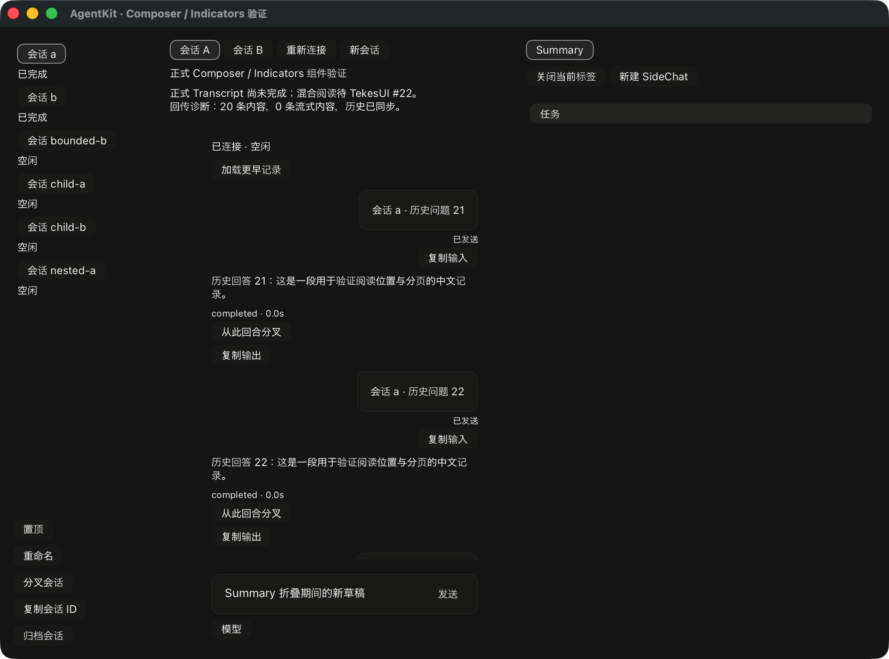

# Summary sections：顺序、折叠与动作身份（实验）

本轮对照当前 ClientKit 的 `ClientAgentSummaryView` / `SummaryProviders` / `SummaryStyle`，以及 Tekes 的 `ClientAgentSummaryHostAdapter`。只读核对后修正 Rust Summary 的两个实际差异：application/host sections 应在默认 providers 之前；section 标题应能折叠，而非静态文本。没有改 Swift、Kernel 或 TekesUI 的默认精确 pin。

## 当前公开行为

- `SummaryInput.host_sections` 按调用方顺序置于默认 providers 前；默认 tasks/subagents/sources/artifacts/usage 继续消费既有 `SummaryFacts::sections`，不另算总数、来源或成本。空 section 省略，重复 ID 在修改原树前拒绝；宿主不能覆盖默认事实。
- 同一 `SummaryView` 按 section ID 保持折叠偏好，包括 section 暂时消失后重现及同实例切换 scope；这与 Source 的本地 `collapsedSections` 一致，不写入 endpoint 或第二套 presentation。已展开且消失的 section 不保留多余模型/内容树。
- section header 使用 TekesUI ButtonContent，开合由公开 Disclosure 模型执行；内容区用公开 Component active、Stack 和 ContainerLayout 组合。关闭时正文同时退出输入、焦点遍历和 AX，原内容节点仍保留。通用命中、按键、focus/capture 和按钮动效仍由库执行。
- 文档上下用 Regular 净空，section 间用 Section 间距；header 后直接接正文，正文行不另加外部 gap。库的字体、颜色、按钮及 focus 样式随主题/token 变化；不复制 Source 的 Metal/AppKit 皮肤。
- 普通事实/标题/状态刷新保留原 header/行控件。若任务 session pointer、子代理目标或 artifact path 改变，则分配新的**动作身份**；已经捕获的旧点击不能查到新目标。折叠前排队的内容动作也不会在关闭后派发。已经发出的 typed intent 保持原 scope/action，宿主继续走既有 binding 的权威检查。
- `SummaryInput.revision` 是整个输入的单调 publication，包含 host sections 的变化；同 publication 的冲突输入在修改前拒绝。局部折叠不伪造 canonical revision。

公开查询为 `displayed_input`、`section_order`、`section_header_id`、`section_expanded`、`row_id` / `action_id` 和 `section_layouts`。任一 section 尚未排版或折叠状态已改变时，几何集合整体不可用，避免把后续 section 的旧位置当成新布局。宿主还需确认它自己的 pane 正在呈现。Summary DTO 已从 UI 包重新导出，第二公开 consumer 可直接构造 host section，不必依赖 runtime/presentation 私有实现。

## 验证范围

组件测试覆盖宿主优先顺序、折叠期间 canonical 更新、原控件保留、隐藏 AX/动作、scope/section 移除恢复、空与不可用区分、冲突 publication 以及任务 pointer 替换后拒绝旧点击。12组实际 CoreText 宽度/主题/字体倍率组合检查 section 间距、header/body 相接、折叠净高和库的焦点/AX行为。

`--components --transcript-content --summary-sections-selftest` 是新增的独立本地原生探针，只允许 owned fixture：实际鼠标折叠 → 原 binding 编辑草稿产生新 snapshot → 关闭状态及原行 owner 保持 → 实际鼠标展开；核对 AX 隐藏与 transcript/submission 数量未变化。它不调用 endpoint mutation；runtime 仍是既有真实 presentation 路径。截图只记录 fixture 中关闭的 section，不是 ClientKit 配对视觉证据。最终日志、源码/二进制/截图哈希和完整检查结果见同名 JSON。

## 仍未完成

[TekesUI #31](https://github.com/TekesApps/TekesUI/issues/31)请求通用标签的行数限制与 tail ellipsis。Source 的 Summary 标题是固定单行并尾部省略，当前公开 pin 的 TextContent/ButtonContent 尚无已核实的等价属性；不能用消费侧截字符串或短标题截图代替。Source hover chevron、完整状态 pane/默认 row 分栏、repository 自定义 row 插槽与宿主产品能力组合也未全部对齐。

当前 `SummaryInput` 仍以 RunScope 作为数据 owner；未选择 session 时的 workspace-only Summary 也需要明确的宿主 context 输入，不能用虚构 session 来挂载。

SidePanel/Sidebar 的其余显示与严格布局、完整 rail/Jump/富内容、默认混合阅读集成及真实三端阅读分页继续开放。本轮不把 Summary 折叠交付扩展成完整 Agent UI 完成，不据此合并或打 tag。
