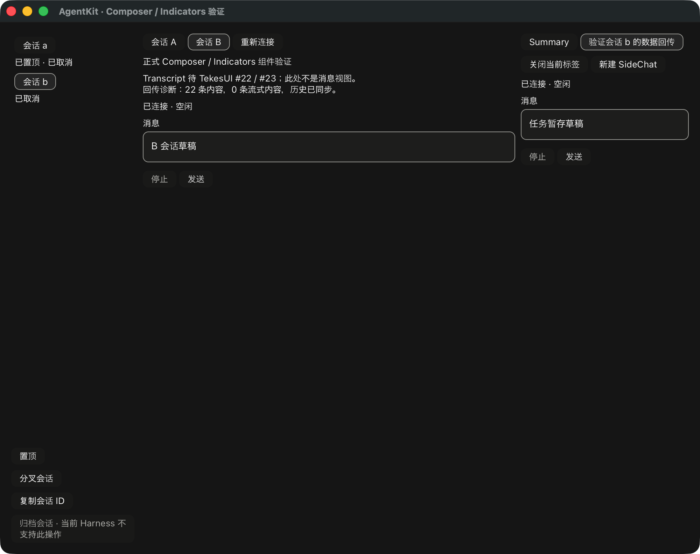

# 任务 pane 接入记录

`TaskPaneBinding` 复用现有 TaskPanelState 处理任务解析，拥有该 pane 的 run 生命周期。
task ID 是 tab 身份；session 指针跟随宿主当前解析出的任务行。未解析、缺失或错误时
不打开 run，不以父会话历史兜底。名称/状态变化保留原 run 和草稿；指针变化、取消和
owner 释放立即撤销旧 binding，捕获的发送回调在异步宿主准备结束后也会重新核对。
Weak guard 避免 source 与缓存 run 形成 Arc 循环。

组件 demo 现在可以接入显式宿主任务源，并路由已有 Summary OpenTask 动作。每个任务
挂载独立公开 Composer/Indicators，主会话切换保留实例。失效后重新出现的同名 pointer
得到新实例；同 session ID 的主会话缓存不能冒充任务 binding。关闭任务 tab 只撤销
本地 pane，不发送远端 cancel/discard。发送、取消仍经过既有 presentation，未另写状态机。

当前 Summary 的同会话 todo 没有独立 run 导航动作，本轮保留该语义。原生脚本由宿主
显式打开 fixture 的已解析任务行，验证同会话数据下的独立 Composer 与父草稿隔离；
它不是 Summary todo 点击测试。独立子任务的控制仍受既有 catalog/continuation 能力
约束；Native bounded 子历史仍走显式 `open_child`，不是 task session 的自动推断。

只读对照 ClientKit `ClientAgentTaskView` 的任务 ID、加载、缺失与 pointer 替换行为，
以及 `ClientEmbeddedRunView` 和 Tekes `ClientAgentPanelHostAdapters` 的宿主边界。
本轮只修改 AgentKit Rust/UI 源码与文档，没有修改 Swift、Kernel 或 TekesUI。
用法及宿主观察责任见 [公开绑定说明](../ui/bindings/README.md#task-pane-resolution)。

新增 5 项测试覆盖：旧 load token、慢历史 baseline、A→B→A、pointer 失效发生在宿主准备
期间、loading/missing/error/foreign 输入、owner drop、同 pointer 的草稿保留、公开组件
挂载与会话切换、主 run 替换拒绝、任务源转向其他 parent 后的卸载、以及 tab 本地关闭。

本地 root 104、UI 79、工具 18 tests、root/UI strict all-targets Clippy、fmt、边界及
Cargo 实际解析的 188 个 TekesUI 输入检查通过。第二公开 consumer 使用 TaskPaneBinding
生成共享 task tab，不导入内部模块或维护另一份 task 状态。

原生脚本验证任务正文只有一次 admission、同回合 assistant 与 interrupted settlement、
暂存草稿未提交、父 A/B 草稿不变和 tab 关闭；同时重跑原 Composer/Sidebar/Summary/
SideChat 脚本。这是隔离 fixture 与合成文本服务，不是物理 IME/VoiceOver 验收。

真实 Kernel 0.9.1、Pi 1.3.0、DSH 0.2.1-rc.2 的协议/历史恢复和原组件到 GPU 路径复验
通过，使用隔离 HOME/dataRoot 与本地合成 provider。三端离屏收据没有打开新任务 pane，
不构成真实三端任务原生交互证据。范围见 [机器收据](rust-agent-ui-task-20261019.json)。

正式 Transcript/RunView、子代理 pane、其余宿主交互、物理 IME 和阅读/分页锚点验收
尚未完成。TekesUI #22/#23 仍开放；public pin 保持 `431093786de47b48cd566d0d9c0eafa088b10d68`。
PR #10 继续 draft，待完整实现、review/CI 后再合并与打阶段 tag。
