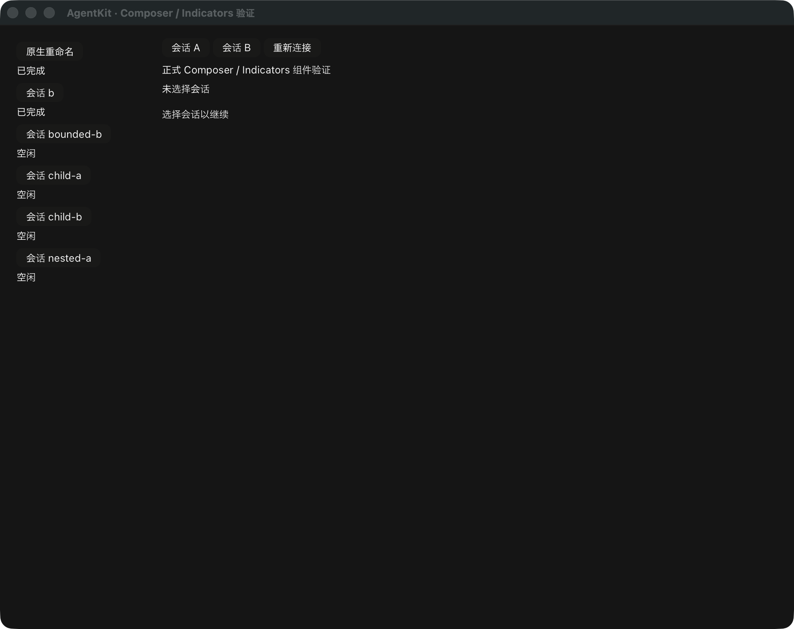

# Sidebar 共享操作接入记录



AgentKit 基线已同步已发布 v0.3.8（`f1daa0ffcf6ced41e21f351e22845455ca78006c`）。
UI lockfile 只更新七个本地 AgentKit 包的版本，修复 PR 合并预览在 main 更新后
无法执行 `cargo metadata --locked` 的问题。TekesUI 仍固定公开
`431093786de47b48cd566d0d9c0eafa088b10d68`；没有切换到活跃工作树或未发布候选。

`ThreadRename` 是独立的临时编辑组件，组合 TekesUI TextFieldContent 与按钮，
不实现编辑/IME 引擎。它接收捕获的 address/action definition/title，阻止空名称、
组字期间提交和重复提交；标题只由共享 inventory 确认，不乐观覆盖列表。
不确定失败后显式重试原 payload 保留 ticket/RPC 身份，已知拒绝或修改名称才产生
新 attempt；没有自动重试。新目标使用新的控件身份，旧回调不能关闭新编辑器。

Sidebar 的 pending 只限制本地动作，不能放宽共享能力。demo 通过同一
SidebarBinding dispatcher 执行重命名、分叉和归档，应用返回的 navigation、
clear-selection 和 warnings。分叉结果即使早于 inventory 到达，也通过新的历史
lease 打开其明确 pointer；迟到结果不抢走更新的选择或组字焦点。归档仅清除仍选中
的原会话，显示明确空状态，保留缓存草稿，不伪造新会话。

owner 归档纳入 ChildRefreshKey，触发既有子代理 catalog 刷新，在读取期间收紧
Composer 控制，最终权限仍由共享层决定。只读对照 ClientKit sidebar 的 rename、
fork 导航代数和 archive 行为，以及 Tekes 的共享宿主边界；没有修改 Swift、Kernel、
TekesUI 或其他仓库。

验证命令使用 Rust 1.95.0、`--locked` 和明确的 UI target directory：

```sh
cargo +1.95.0 test --workspace --locked
cargo +1.95.0 test --manifest-path ui/Cargo.toml --workspace --locked
cargo +1.95.0 clippy --manifest-path ui/Cargo.toml --workspace --all-targets --locked -- -D warnings
tekes-agent-ui-demo --components --thread-actions-selftest
tekes-agent-ui-demo --components --native-selftest
```

root 105、UI 88、工具 18 tests 通过；root/UI strict all-targets Clippy、fmt、
依赖边界与 Cargo 实际解析的八个 TekesUI 包、188 输入检查通过。第二公开 consumer
可独立挂载 ThreadRename。测试覆盖 pending、组字屏障、错误分类/显式重试身份、
过期回调、canonical metadata、分叉 replay、晚到导航、归档空选择与子代理撤权。

原生隔离 fixture 的 `NATIVE_AGENT_THREAD_ACTIONS_SELFTEST_OK` 验证组字中点击不提交、
提交后共享标题回传、分叉恰好一次并导航、归档清除选择、重新选择及父草稿隔离。
完整原生回归另覆盖原有 Composer/Indicators、Sidebar/Summary、任务、SideChat、
独立子代理发送/流式/取消及有界历史分页。第一次完整回归因脚本等待空草稿的发送
按钮启用而超时失败；已改为等待 catalog 读取完成和控件挂载，并增加空草稿可输入
但不可发送的回归断言，修正后通过。该失败不是通过项。

真实 Kernel 0.9.1、Pi 1.3.0、DSH 0.2.1-rc.2 的协议、历史恢复、各自生命周期能力、
子历史路径及共享 runtime 组件到 GPU 路径复验通过，使用隔离 HOME/dataRoot 和
本地合成 provider。三端离屏窗口没有执行新增线程操作，不能据此声称三端原生
线程操作验收。分层结果、日志 hash 与截图 hash 见 [机器收据](rust-agent-ui-thread-actions-20261019.json)。

以上是合成文本服务和本地 fixture 证据，不是物理输入法、VoiceOver、正式
Transcript/RunView 或真实三端所有线程操作的原生验收。正式 Transcript 继续遵守
[视觉与阅读契约](rust-agent-ui-contract.md#transcript-结构与视觉契约)。
PR #10 保持 draft，完整交付仍需结构化 Transcript、RunView、剩余 Composer 能力
入口和完整宿主/三端/原生验收，之后才能合并并打阶段 tag。
