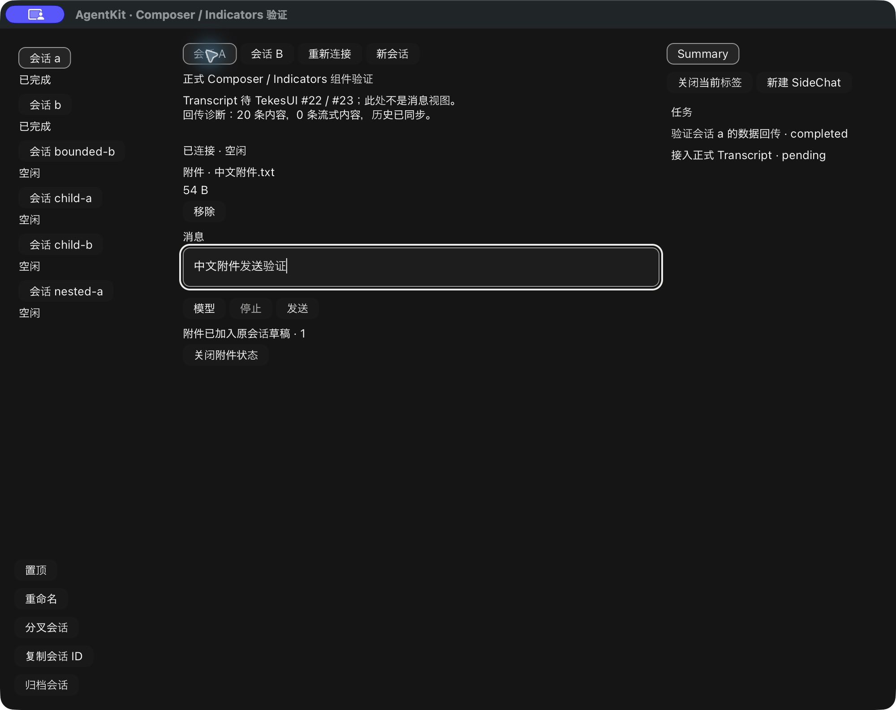

# 文件附件的宿主选择器与状态组件

此记录延续 [共享上传绑定](rust-agent-ui-attachments-20261020.md)，没有把整个 Agent UI 目标缩成附件交付。AgentKit 已发布基线仍为 v0.3.8；新增 API 尚在草稿 PR #10。TekesUI 固定 `431093786de47b48cd566d0d9c0eafa088b10d68`，8 packages /188 文件的实际输入校验保持一致。

## 所有权与接口

- presentation 提供 `AttachmentTransferSnapshot / AttachmentTransferPhase` 瞬态操作事实，独立于 RunSnapshot；不是另一套 Run 状态机。
- `AttachmentSelection` 通过 `snapshot/subscribe` 发布 Selecting、逐文件 Uploading 与终态。不制造字节百分比。`cancel_selection/fail_selection` 仅在上传前生效；上传开始后拒绝假装取消网络请求。
- 公共 `ComposerUploads` 只组合 TekesUI Stack/Text/Button。一个实例绑定一个 request/destination authority，拒绝旧/冲突 revision、外来 request 和终态重新进入 pending。仅终态允许 Dismiss；宿主传入组字交互 gate。新 operation 用新 namespace，旧按钮不能关闭新操作。
- demo 宿主提供系统选择器、普通文件读取、窗口 wake 与布局；Kit 没有路径、窗口或系统对话框依赖。demo 的 macOS 依赖固定 `rfd =0.17.2`，MIT、关闭默认 features，没有 Swift 源码或工具链。依赖边界脚本明确限制其只能出现在 demo 的 macOS target。
- 依据 [RFD 官方线程契约](https://docs.rs/rfd/0.17.2/rfd/#macos-non-windowed-applications-async-and-threading)，在主线程构造 dialog future，由既有 executor await。文件读取使用阻塞 worker，只接受普通文件，每个文件读取最多 transport ceiling +1 字节，另设宿主 32 文件/32 MiB 总量上限；端点 policy 可以更严格。generic file 的 MIME 使用 application/octet-stream，不按扩展名冒充内联图片。
- Main Composer 上传期间仅限制原 binding 的 Send/entries，不限制其他会话；编辑与既有取消策略保留。完成结果写入原操作，拒绝未终态或 request/destination 不符的回调；不切换导航、不抢焦点。原选择的不可变字节与 known receipts 留到显式 Dismiss。SidePanel 附件选择器尚未接入。

## 原生系统选择器证据

用当前构建的 Rust 二进制生成独立临时 `.app`，仅连接本地合成 SEP fixture，没有收费模型和凭证。真实 CUA 原生操作完成：

1. 点击附件入口，出现真实 macOS Open sheet；选择本轮拥有的 `中文附件.txt`，54 字节。
2. 原会话 A 显示文件名、54 B 和“附件已加入原会话草稿 · 1”。
3. 填入测试正文，切到 B 时正文、附件和 A 的状态均未带入；返回 A 恢复全部内容。
4. 点击现有 Composer 的发送，观察执行中/1 条流式内容，随后空闲/0 条流式内容/已完成；发送后正文和附件卡片清空。
5. 关闭成功状态后再次打开系统选择器并 Cancel，观察“已取消文件选择”，未出现附件卡片或可发送内容。
6. 保存最终构建的截图与 AX 文本，关闭本轮测试 app。

截图是实际原生窗口，不是离屏渲染。它只证明本地 fixture 上的系统选择器、状态组件、草稿隔离和发送/回传路径，不证明文件在真实三个 harness 中可读取，也不是正式 Transcript 或物理 IME/VoiceOver 验收。中文正文通过 AX 设置；自动化组字测试使用合成文本服务。

初次直接 CLI 启动的窗口没有可绑定的 app identity，改为同一已构建二进制的临时 bundle。起始数字索引点击未打开选择器，改用当前截图坐标后成功；后续系统按钮和组件操作可用当前 AX 索引。一次读取 full AX 后沿用旧索引被工具拒绝，刷新索引继续；没有修改产品事件过滤、像素布局或测试断言。最终构建重新走完选择/草稿隔离/发送/取消路径。既有五项原生回归 marker 亦通过；第一次误用 `--selftest` 只打开普通窗口，终止该精确进程后使用实际的 `--native-selftest` 执行，空日志不计通过。

## 组件与共享验证

测试覆盖 progress watch 与取消边界；状态旧版本/外来 authority/终态/组字 gate/一次 Dismiss；A/B 草稿及 pending gates；取消无上传、旧按钮不影响下一次 request；中文 preedit 不打开 picker、不误发送；过早/错目标完成回调；受限宿主读取与未知图片语义。第二 consumer 独立挂载状态组件。

完整命令、计数、binary/AX/screenshot hash 与每层证据边界见 [JSON 收据](rust-agent-ui-upload-host-20261020.json)。

## 仍待完成

真实 Native/Pi/DSH 上传绑定→草稿→发送→文件读取/数据回传，SidePanel picker、预览与专用失败/未知结果对账 UI、内联图片，以及跨窗口/进程的持久化恢复。当前关闭窗口/进程可能中止本地 future，但不能据此宣称服务端取消；结果应视为未知并显式对账。关闭终态状态只释放本地缓冲，不自动删除远端文件。

正式 Transcript/RunView、多块历史/推理/工具内容和阅读/分页锚点仍需 TekesUI #22/#23 的可消费公共交付及实际联调；本轮未修改上游或提升 pin。PR 保持草稿，不合并、不打 tag。
