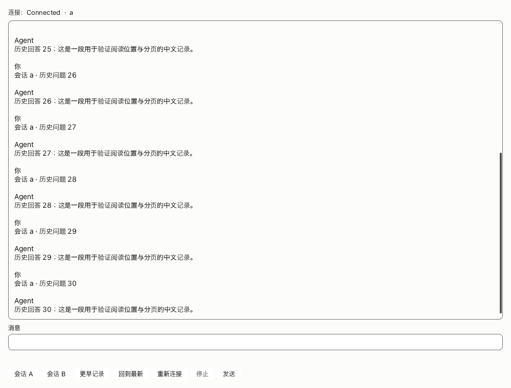

# Rust Run demo（开发试点）

正式共享组合名为 **RunPort**；Sidebar、RunPort、SidePanel 的目标宿主接口是 TekesUI ProcessContainer。当前保留原同进程 Content 路径，远端输入/IME/滚动/AX 等待 [TekesUI #48](https://github.com/TekesApps/TekesUI/issues/48)。[迁移说明与验收矩阵](../docs/rust-agent-ui-run-port-20261022.md)区分 API 改名、同进程运行与尚未完成的跨进程接入。

Output copy now captures the original whole turn via `TranscriptTurnCopy` rather
than selecting one final item. `TranscriptCopyIntent::source()` distinguishes a
message from `TurnOutput { turn_id, item_ids }`; `message()` returns Option and is
None for a turn aggregate. Hosts still claim once and write captured `text()`.
See the [copy/display contract](../docs/rust-agent-ui-turn-output-copy-20261022.md)
for raw source order, live-owner gating and independent response authority.

The demo now admits original copy controls across the mounted main RunPort,
selected writable pane and readonly child while a Run Composer owns preedit.
Copy keeps its original scope; AX Focus and endpoint read/send/navigation remain
separately gated. The [cross-pane contract](../docs/rust-agent-ui-cross-pane-copy-20261022.md)
records the same-process native probe, private pasteboard opt-in and remaining
ProcessContainer/Task/SideChat native acceptance boundaries.

只消费 TekesUI，复用 AgentKit v0.3.8 的 `SessionRuntime` / `RunController` / `RunSnapshot`。
组件层不实现另一套 Run 状态机。默认 headless workspace 和发布 API 保持独立。

[短接入契约](../docs/tekesui-integration-contract.md) 定义所有权、输入、回调、焦点、IME 和阅读责任；
[TekesUI 缺口](../docs/tekesui-gaps.md) 列出所需上游事件/属性，
[七项开发任务](../docs/tekesui-development-tasks.md) 给出优先级与逐项验收标准。



## 正式组件开发

`RunSurface` 仅是现有协议/控件测试宿主，不是标准 RunPort。正式组件契约、App 的 input/output/footnote 布局、基础 Issue 和完整交付账本见 [Rust Agent UI 接入契约](../docs/rust-agent-ui-contract.md)。

可独立挂载的组件包括 Composer、ComposerNotice、ComposerContext、ComposerChoices、AnnotationEditor、ComposerUploads、Indicators、Sidebar、ThreadRename、SidePanel、SummaryView、InputMessage、OutputMessage、TurnFootnote、TranscriptContent、ReadOnlyTranscript 和 RunPort。它们使用同一套共享 presentation；RunSurface/ComponentDemo 是测试与接入宿主。主会话和可写 pane 已挂载 RunPort，有界子历史使用 ReadOnlyTranscript；完整 Transcript 的阅读锚点、富内容与最终体验验收仍待完成。

[独立阅读事务候选联调](../docs/rust-agent-ui-reading-candidate-20261020.md)保留早期候选的隔离回放记录。当前默认公开精确 pin 已接入 RunPort 的[持续阅读事务](../docs/rust-agent-ui-continuous-reading-20261021.md)，分页、reveal、焦点与 IME 的最新验收范围见[本轮复核](../docs/rust-agent-ui-panel-navigation-20261022.md)，不以早期候选状态描述当前实现。

正式 RunPort 的 [共享会话列](../docs/rust-agent-ui-column-layout-20261020.md)使用公开 `RunColumnLayout` 配置限宽、全宽或子 pane 边距，改布局不替换原组件。

[RunPort 整帧准备](../docs/rust-agent-ui-run-preflight-20261021.md)公开只读业务计划与提交重检；默认宿主已通过公开 SDK 的 `publish_run_reading_update` 在原阅读事务内发布整帧，持续检查原编辑器、目的地与版本。

可选的[系统拼音软件探针](../docs/rust-agent-ui-system-ime-20261020.md)使用 `python3 scripts/test-system-ime.py --demo ui/target/debug/tekes-agent-ui-demo`（在仓库根目录执行）。它要求当前已选简体拼音和已有事件权限，不改变输入源，只向自己启动的 fixture 进程发送键码；通过真实 marked text、发送/导航屏障、确认和单次提交检查。实体键盘、候选窗视觉和完整 IME 验收仍未完成。

Composer 已接入输入/草稿/发送/取消、公开模型目录与发送前配置、初始预设/自动创建、内容卡片移除和已有批注评论编辑。Main 已接入真实 macOS 文件选择和公共上传状态；三端公开上传→草稿→发送→历史/重连已验证，Native/Pi 另验证通用文件字节读取，DSH 暂无通用文件下载。SidePanel 选择器已接入任务、独立子代理和 SideChat；预览/持久化对账、选区批注捕获/来源高亮、内容移除 undo 和其余能力入口仍待适配。模型、创建和评论编辑的证据分别见 [模型闭环](../docs/rust-agent-ui-model-integration-20261019.md)、[新会话](../docs/rust-agent-ui-creation-20261020.md)、[评论编辑](../docs/rust-agent-ui-annotation-editor-20261020.md)。

Sidebar 使用共享列表、置顶和动作 dispatcher，已接入选择、复制、重命名、分叉和归档。SidePanel 组合任务、子代理、SideChat 与 Summary；任务与独立子代理保留各自 Composer/Indicators，有界子历史是只读来源。SideChat 保留临时 pointer 与 Unknown/Closing 草稿，源撤销、晚结果和异步准备继续由原绑定检查。

SidePanel 是受控组件，宿主提供有序 `tabs` 和可为空的 `selected`；先排空原控件 intents 再发布下一帧。demo 导航按 ClientKit 保留打开顺序，关闭当前 tab 后选最后一个剩余 tab，全部关闭后保持空文档；宿主示例按钮 `OPEN_SUMMARY` 显式重开 Summary，不是新增 Kit launcher。关闭后旧 `PanelContentToken` 失效。晚到 SideChat 回包不重选已关闭文档，关闭确认不清除主 Composer 的组字焦点。详见[导航契约及分层证据](../docs/rust-agent-ui-panel-navigation-20261022.md)。

Composer 的真实输入胶囊公开为 `ComposerIds::input_band`；现在保留9个连续 ID，原编辑器及8个既有 ID不变。当前公开固定 SDK 已提供留白焦点及原生 IME 转交；消费证据见下方公开版本接收记录。宿主绑定时机、替换后重绑及验收边界见[接入记录](../docs/rust-agent-ui-composer-padding-20261021.md)。

[绑定包](bindings/README.md) 连接原 RunController、history lease、任务/子代理/SideChat 生命周期。宿主拥有窗口、布局、导航与系统能力；来源替换不能重定向旧回调。第二 public consumer 只依赖两个公开 UI 包。

`--components` 打开实际组件验证窗口，可与 `--offscreen` 或显式 `--endpoint-config` 组合。原生 fixture 的 `--native-selftest` 及各单项模式验证合成文本服务、发送/取消/重连、草稿与 pointer 隔离；真实三端离屏接入使用 `--ui-components`。原生阅读/分页及三端专项已有分层证据；物理键盘/候选窗、完整宿主与全部 Views 视觉验收仍需完成。最新范围与收据以 [交付账本](../docs/rust-agent-ui-contract.md) 为准。

## 依赖

- Rust 1.95.0、macOS + Metal（原生窗口/文本服务/GPU）；Python 3.11+（准备和边界检查）。
- AgentKit 基线 v0.3.8（公开 main `f1daa0ffcf6ced41e21f351e22845455ca78006c`）；最新独立三端 UI 验收使用 Kernel v0.9.3，历史收据按各自实际版本保留。
- TekesUI composition 仍是实验 API，但实验开发源码固定为公开 Git commit `09b4bab44b6dfa65487250ea816b610b9df59095`（公开 tag `remediation-toolbar-checkpoint-20261021`）；6 个直接依赖和2个传递依赖均由 Cargo 按该完整 rev 取得，ui/Cargo.lock 同步固定。
- `tekesui-source.json` 的 kind 为 `published-git-revision`，241文件 SHA-256 为 `44b3174022584d3c099a45b86892d17dbf948905476c0f038be104df12aefe46`，对应实际八包依赖闭包；原431/8cf/2ee/129基线在 `baselines/` 原样保留。固定的是不可变commit，不跟随分支HEAD。
- 旧e4 manifest、lockfile、消费适配和188依赖另有备份；旧 `.deps/tekesui` 原样保留但不参与当前构建。无需从兄弟工作树复制代码，`prepare-tekesui-demo.py` 在公开pin模式拒绝path/capture。
- UI包继续 `0.0.0` / `publish=false`；公开源码pin不代表AgentKit UI稳定版。最新验收与独立CI边界见 [最新公开接收](../docs/tekesui-toolbar-public-intake-20261021.md)及[reading/reveal复核](../docs/rust-agent-ui-public-reading-recheck-20261022.md)。

最新正式组件进展：[原生 Jump/回到最新](../docs/rust-agent-ui-jump-latest-20261021.md)；仍为实验 API，未代表完整 ClientKit Views 验收。

只读子历史宿主请使用[完整pane阅读事务](../docs/rust-agent-ui-readonly-reading-20261021.md)，不要在已声明SDK reading document后直接替换正文。

[三真实harness流式阅读验收](../docs/rust-agent-ui-stream-reading-native-20261021.md)覆盖旧回合锚点、中文合成preedit、重连与A/B隔离；普通完整产品UI仍未验收。

## 构建与运行

从 AgentKit 根目录：

```sh
python3 scripts/check-ui-boundaries.py
cargo build --manifest-path ui/Cargo.toml --locked -p tekes-agent-ui-demo
ui/target/debug/tekes-agent-ui-demo
```

默认 transport 是独立的本地 SEP fixture：两个会话、有界历史、逐块回传和可取消运行，不需要凭证或模型。
按钮提供发送、停止、历史分页、回到最新、重连、切换 A/B。候选 Composer 已消费公共多行 Grow 视口；Enter 换行，业务发送仍仅通过显式按钮。
宿主订阅已有 `RunController::subscribe()`，通过公开 `WindowWake` 投递通知；异步操作结果入队后同样 wake。没有业务 frame pump；原控件的有限过渡仍按需请求动画帧。

真实 Native、Pi、DSH 都通过 `--endpoint-config` 接收宿主显式 JSON。A/B 对应所选 endpoint 的两个已有 session，必须互不相同；宿主负责模型/执行参数。demo 启动不创建真实会话或修改模型；`--components` 中显式点击新建 SideChat 会在支持的 endpoint 创建临时 fork，关闭操作会取消并丢弃该临时会话：

```json
{"endpointId":"native-ui","url":"http://127.0.0.1:PORT","bearerEnv":"MY_EXPLICIT_BEARER","sessions":["SESSION_A","SESSION_B"]}
```

```sh
ui/target/debug/tekes-agent-ui-demo --endpoint-config /absolute/native.json
```

Native 可显式设置 `"kind":"native"`；省略 kind 兼容旧配置。令牌仅从 `bearerEnv` 指定的环境变量读取。

Pi 1.3.0：

```json
{
  "kind":"pi", "endpointId":"pi-ui", "sessions":["SESSION_A","SESSION_B"],
  "executable":"/absolute/pi-runtime/node/bin/node",
  "arguments":["/absolute/pi-runtime/node_modules/@earendil-works/pi-coding-agent/dist/bundle/cli.js"],
  "dataRoot":"/absolute/owned-agentkit-pi-data",
  "environment":{"HOME":"/absolute/authorized-home","PATH":"/usr/bin:/bin"},
  "environmentFromEnv":{"PROVIDER_API_KEY":"HOST_PROVIDER_KEY"},
  "extensions":[], "sessionRoots":[]
}
```

Pi 复用同一个 AgentKit dataRoot 的 session registry/pointer，且该目录同时只能被一个 connector 持有。
`executable`、`dataRoot`、`extensions`、`sessionRoots` 必须为绝对路径。`sessionRoots` 仅授权现有 adapter 采用该范围内的 session 文件，不扫描全局目录。
子进程不继承宿主环境；普通输入放在 `environment`，敏感值以 `environmentFromEnv` 的“子进程变量名 → 宿主变量名”显式映射。两者不可写同一目标变量。
provider/model、代理及证书等运行所需输入均由宿主配置。

DSH 0.2.1-rc.2（兼容 0.2.0-rc.2）：

```json
{"kind":"dsh","endpointId":"dsh-ui","url":"http://127.0.0.1:PORT","cookieEnv":"HOST_DSH_COOKIE","sessions":["SESSION_A","SESSION_B"]}
```

可将 `cookieEnv` 替换为 `bearerEnv`，不能同时设置；显式无认证的宿主可省略两者。
沿用 DSH connector 的官方运行版本探测，宿主需提供 `/api/tekes/harness-version` 只读桥接，不能用配置伪造版本。
三个 backend 共用现有 SessionRuntime / RunController 和同一个 RunSurface，发送使用已有 session 的实际模型配置。
未知 kind/字段、错误 session 槽位、缺失凭证变量均报错，不回退 fixture。通用 TekesUI 控件与状态逻辑保持上游所有。

## 验证

```sh
cargo test --manifest-path ui/Cargo.toml --workspace --locked
cargo clippy --manifest-path ui/Cargo.toml --workspace --all-targets --locked -- -D warnings
ui/target/debug/tekes-agent-ui-demo --native-selftest
ui/target/debug/tekes-agent-ui-demo --offscreen /tmp/agentkit-ui-demo.png
python3 scripts/test-real-session-endpoints.py \
  --kernel-root /absolute/kernel-0.9.1-checkout \
  --pi-root /absolute/pi-1.3.0-runtime \
  --dsh-root /absolute/dsh-0.2.1-rc.2-runtime \
  --ui-demo "$PWD/ui/target/debug/tekes-agent-ui-demo" \
  --ui-output /tmp/agentkit-native-ui.png
```

`--native-selftest` 只使用本应用 fixture，通过 TekesUI 公开 selftest 接口投递本窗口事件和合成文本服务，
完成后自动关闭；不读取其他应用，不发送全局输入。不能与真实 endpoint 配置组合。
`--offscreen` 使用真实 GPU 渲染，不是原生窗口截图。三端集成脚本使用临时 HOME/dataRoot 和本地合成 provider，不调用付费模型；只传一个 runtime root 也可单端运行。
`--ui-output` 保留 Native 输出路径；Pi/DSH 分别加 `-pi`/`-dsh` 后缀。离屏 stdout 只输出数量/状态收据，不输出会话正文或凭证。

| 层 | 本轮证据 | 边界 |
|---|---|---|
| presentation / 组件 | 流式、取消、echo 去重、晚回包不清除其他草稿、scope 回调捕获、重连/分页 | 复用既有 controller |
| 第二 consumer | `consumer/` 独立包仅消费公开组件 API，编译与挂载测试 | 非第二原生产品 |
| 阅读 | 实际 Earlier 连续两页、尾追加/宽度/文字缩放、选区/焦点与 A/B 阅读恢复通过 | 原生窗口分页体验待验收 |
| 原生/物理/VoiceOver | 接收037的分层证据，公开pin188输入字节一致；本会话未重新现场操作 | 保留原二进制/源身份，不把GPU或合成输入当人声验收 |
| 真实 Native / Pi / DSH → GPU | 显式 SEP、RunController、已恢复 final assistant、离屏 PNG，见[三端记录](../docs/tekesui-three-endpoint-demo-20261019.md) | 非原生交互/真实模型 |
| 性能与完整UI成熟度 | 本轮不测性能，不宣布全组件/全主题验收 | UI仍experimental |

当前已接入公共异步唤醒、前插锚点、多行视口、输入元数据、受控事务和类型化动作，并固定公开pin。原始需求与历史收据保留，最新关闭范围、证据和上游Gallery CI失败边界以正式pin复验记录为准。
上述 RunSurface 早期试点不承担正式业务组件。当前 Composer、任务/子代理/SideChat、Summary 和附件状态的组件进度以本页开头及交付账本为准；完整 Markdown/工具内容与正式 Transcript 仍待上游能力。

本次 P0 联调与验收边界见 [记录](../docs/tekesui-p0-closeout-20261018.md)。

#19 指针迁移、共享选择修复与最新显式快照见 [记录](../docs/tekesui-pointer-metadata-20261018.md)；原生AgentKit验收仍未完成。

交接后的 [消费侧独立复验](../docs/tekesui-consumer-verification-20261018.md)：当前快照 UI27/headless76、真实 Native SEP 到 GPU 通过；尚非原生窗口或生产验收。

交付包的一键复现、失败收据和公开不可变 pin 字节比对见 [消费侧验收工具](../docs/tekesui-acceptance-tools.md)；工具不提升当前冻结候选。

Sidebar 重命名、分叉和归档通过共享 dispatcher 接入，归档后显式清除选择且保留草稿。`--components --thread-actions-selftest` 使用隔离 fixture 验证这些操作；不可与真实 endpoint 配置组合。见 [操作接入记录](../docs/rust-agent-ui-thread-actions-20261019.md) 和 [公共绑定说明](bindings/README.md#shared-inventory-and-thread-actions)。

`--components --model-choices-selftest` 使用隔离 fixture 验证模型目录、选择、发送前配置回执与流式结束。真实三端验证脚本可加 `--ui-model-choices`（须同时提供 `--ui-components --ui-demo`），仅在脚本自建的隔离会话与本地合成 provider 上执行额外一条模型选择证明消息。不要将离屏证明等同于三端原生窗口验收。

初始预设通过 `InitialPresetChoices` 适配 Native/Pi 初始目录和 DSH roster，仅在创建时应用。已有会话不提供预设切换。三端脚本的 `--ui-initial-presets` 在隔离状态下验证公开面板选择、共享 controller 创建和单次发送；离屏证明不替代原生预设验收；交互式新会话入口的进展另见 [新会话记录](../docs/rust-agent-ui-creation-20261020.md)。见 [预设接入记录](../docs/rust-agent-ui-initial-presets-20261020.md)。

`--components --creation-selftest` 使用隔离 fixture 验证交互式新会话、公开预设选择、组字屏障和正常 Composer 发送，保留原草稿。真实 endpoint 窗口需显式提供 `--create-cwd ABSOLUTE_PATH` 才启用新会话入口。创建失败保留 session/RPC 身份并阻止替代点击；专用失败对账 UI 尚未实现。见 [新会话接入记录](../docs/rust-agent-ui-creation-20261020.md)。

`--components --annotation-selftest` 验证已有批注评论的原生编辑、组字屏障和共享发送。真实三端脚本可加 `--ui-annotation-editor`，自动包含 context 证明；它不提供来源高亮或结构化历史卡片。公共 AnnotationEditor、原 binding 写入与快照确认流程见 [评论编辑接入](../docs/rust-agent-ui-annotation-editor-20261020.md)。

## 文件附件接入与三端验收

使用 `--components --file-attachments` 可打开本地合成 SEP fixture 上的真实 macOS 系统选择器；真实 endpoint 配置只按公开上传/policy 能力提供入口。宿主负责路径/权限/受限读取，Kit 负责原 destination、一次上传尝试和 canonical draft CAS。

三端脚本追加 `--ui-components --ui-attachments` 会从公开 Composer 入口捕获原请求，再以隔离测试文件 provider 执行上传、A/B 草稿隔离、共享 Send、历史恢复和重连检查。Native/Pi 另外从公开接口回读字节并拒绝其他 session；Pi 的历史文件语义是路径引用；DSH 保留文件元数据，通用文件下载保持不支持。该 flag 不启动系统对话框，也不等同于三端原生窗口验收。

[真实系统选择器记录](../docs/rust-agent-ui-upload-host-20261020.md) 与 [三端数据闭环记录](../docs/rust-agent-ui-upload-three-20261020.md) 分开保存；物理 IME、正式 Transcript 和阅读锚点仍未验收。

SidePanel 附件共享相同选择/上传/状态组件，按原 binding/request 保留；关闭来源后的回执不会进入父草稿。同 session 地址不同 controller 的操作也不会合并。有界子历史与独立 one-shot 子代理不提供上传。原生选择器与源替换测试分层证据见 [SidePanel 附件记录](../docs/rust-agent-ui-pane-uploads-20261020.md)。

正式 Transcript 前的公共 `TranscriptDocument` 只读组织消息、工具及 footnote lanes，保留已有身份/覆盖事实，第二 consumer 直接使用。它不含渲染或阅读控制器，不改变 Transcript/RunPort 尚未交付的状态。见 [数据模型与证据](../docs/rust-agent-ui-transcript-document-20261020.md)。

`--components --session-notice-fixture --offscreen <PNG>` 只验证合法无 turn 提示进入文档出口，`documentProjection.sessionNotices` 必须为 1；不是正式提示卡片的视觉验收。

公共 `TranscriptSourcePosition` 和 `TranscriptSection::event_order()` 提供已知事件/容器顺序及明确的 unplaced 覆盖状态；ordinal 不作身份或锚点，正式文本块与工具交错仍待实现。见 [来源顺序说明](../docs/rust-agent-ui-transcript-order-20261020.md)。

`TranscriptItem.content_blocks` 规范化公开消息内部的 Text/Reasoning/ToolCall/Attachment/Unknown；None 明确保留聚合/旧内容覆盖状态。第二 consumer 直接读取覆盖与待解析工具引用，见 [内容块契约](../docs/rust-agent-ui-transcript-content-20261020.md)。

`--components --history-page-proof --offscreen <PNG>` 从公开 TranscriptPaging 按钮捕获原 A 的读取请求，验证 B 草稿隔离、源回执发布和新 epoch 历史保留，不是正式 Transcript 或阅读锚点验收。真实三端脚本加 `--ui-components --ui-history-pages` 可在隔离长会话上复验。公共接口见 [分页读取契约](../docs/rust-agent-ui-history-paging-20261020.md) 和 [分页控件](../docs/rust-agent-ui-paging-controls-20261020.md)。

`InputMessage` 是可独立挂载的用户消息行：默认 TekesUI Surface 气泡右对齐，caption 在气泡外靠右，正文使用公开只读 Content 文本服务。`--components --input-message-proof --offscreen /tmp/input-row.png` 在测试宿主挂载一个真实 snapshot 输入行；它不是完整 Transcript，附件/结构化原始信息现已支持，富内容预览与混合锚点仍待实现。

`OutputMessage` 从同一份 `TranscriptDocument` / `TranscriptSection` 消费机器内容，所有正文、推理、工具和原始数据详情靠左。`with_labels` 提供宿主 copy/工具详情格式化，样式继续由 TekesUI 提供。正文历史与流式更新使用同一公开只读文本组件，工具 DTO 仅在当前 section 查找；不猜测流/持久消息关联，不把工具结束当成 turn 结算。局部展开动作由宿主将 `drain_actions()` 的结果交给原行的 `handle_actions()` 后重新渲染。

`--components --input-message-proof --output-message-proof --offscreen /tmp/message-rows.png` 可挂载两类真实 fixture 内容行；真实三端脚本的 `--ui-components --ui-history-pages --ui-message-rows` 验证恢复历史的消息行消费、分页与重连。完整 Transcript、turn footnote、Markdown 富内容、混合锚点和物理 IME 仍有独立验收门禁，详见 [机器内容行](../docs/rust-agent-ui-output-message-20261020.md)。

`TurnFootnote` 独立组合 turn 的次级信息及共享动作，保持在机器正文外靠左。`TurnActionDispatcher` / `TurnActionRequest` 绑定原 RunBinding 与稳定 RPC ID，已知拒绝/完成可由下一次显式点击继续，未知结果保留禁用。新建分叉的导航始终由宿主核对原导航 token 后决定。

`--components --input-message-proof --output-message-proof --turn-footnote-proof` 显示独立内容行和 turn aside；`--turn-fork-proof --offscreen /tmp/footer.png` 明确启用一次分叉验证。真实端点脚本的 `--ui-turn-footnote` 只在隔离临时会话中验证同一动作链；这些 opt-in 探针不是正式 Transcript / RunPort。接入、限制和分层证据见 [turn footnote](../docs/rust-agent-ui-turn-footnote-20261020.md)。


`TranscriptContent` 是公开的混合内容组件，组合规范化 InputMessage / OutputMessage / ToolActivity / TurnFootnote。用户附件位于正文气泡上方，外置 caption 在下方，整体右对齐；机器内容左对齐。样式直接继承默认 TekesUI 组件、tokens 与宿主主题，升级固定 UI 版本后统一体现，不维护 AgentKit 样式副本。

用户文本的外置复制按钮通过 `TranscriptCopyIntent` 捕获原消息文本，RunPort 返回 `CopyTranscript`，只读组件单独提供 `take_copy_intents`。宿主按事件顺序、一次 `claim()` 后写系统剪贴板；离线和只读不会禁用已有文本复制。纯附件不提供文本复制。接入、状态边界与本轮失败/成功证据见[输入复制记录](../docs/rust-agent-ui-input-copy-20261020.md)。

输出 footnote 的复制也使用相同回调，由共享 `TranscriptSection::final_output()` 选择唯一最终正文；不复制推理或工具详情，不回退到最后一条消息。独立 TurnFootnote 消费方用 `update_with_output` 显式传入该目标；机器内容和操作继续靠左。公开 API、三端恢复验证与限制见[输出复制记录](../docs/rust-agent-ui-output-copy-20261020.md)。

```sh
ui/target/debug/tekes-agent-ui-demo --components --transcript-content
ui/target/debug/tekes-agent-ui-demo --components --transcript-content --offscreen /tmp/transcript-tree.png
```

实验宿主使用公共 ScrollContent，不提供稳定子项阅读事务或富文本能力；此内容树不等于完整 Transcript / RunPort。真实三端脚本可加 `--ui-components --ui-transcript-content --ui-history-pages --ui-attachments`；不能同时启用独立的 `--ui-message-rows` / `--ui-turn-footnote` 探针。公开接入与证据见[内容树记录](../docs/rust-agent-ui-transcript-tree-20261020.md)。


[`RunPort`](../docs/rust-agent-ui-run-view-20261020.md) 现提供独立的公开组合和类型化意图出口；`standard(namespace, row_pool, scope)` 直接包含混合内容树。实验宿主 `--components --transcript-content` 已复用它，窗口/导航/执行器仍由宿主提供。完整更新使用同帧 RunSnapshot、gate 和原绑定分页事实；焦点改变前按 `allows_focus_target` 维护组字屏障。原生 receipt 的 `runPortComposition.mounted=true` 只证明组合挂载，`completeRunPort=false` 继续表示完整验收未通过。


`ReadOnlyTranscript` 为 Native 有界子历史复用同一内容树，显示真实消息与来源调用详情，只有显式读取回调。新 `PaneSnapshot::ReadOnlyChild` 带原读取调用 publication/epoch；`ChildPaneBinding::read_intent` 在 IO 前校验来源并只允许一次 admission。真实脚本可加 `--ui-components --ui-bounded-child --kernel-root <root>`，另存 `-bounded.png` 和 `NATIVE_UI_BOUNDED_COMPONENTS_RECEIPT`，不要求该 tab 同时挂 Summary。见[只读子历史契约](../docs/rust-agent-ui-readonly-child-20261020.md)。

共享绑定现支持原 committed feedback frame 的一次性评分/备注 CAS；三端真实验证与错误语义见[写入契约](../docs/rust-agent-ui-feedback-cas-20261020.md)。评价已挂入正式 Transcript 内容树，专项原生交互现已补齐（见下文）；`--feedback-write-proof` 仅用于显式启用的隔离验证。

独立公开 `TurnFeedback` 与备注编辑器现可挂载，使用原 binding 的 committed frame 和一次性 gesture bridge；详见[控件接入](../docs/rust-agent-ui-feedback-controls-20261020.md)。`--feedback-controls-proof` / 三端脚本的 `--ui-feedback-controls` 显式验证真实读写及浅深色 offscreen 渲染，不代表原生 UX 已完成。后续[Transcript 接入](../docs/rust-agent-ui-feedback-transcript-20261020.md)已提供 per-turn mount，三端脚本使用 `--ui-feedback-transcript` 通过实际 RunPort/Transcript 路由验证。

三端脚本新增 `--ui-native-feedback`，在自有临时会话中顺序打开真实 macOS 窗口，以自动化 AppKit 点击/文本服务驱动正式 Transcript 评价入口；见[专项原生窗口验收](../docs/rust-agent-ui-feedback-native-20261020.md)。合成 marked text 与物理 IME/VoiceOver 分开，不扩大为阅读锚点验收。

[备注表单接入更新](../docs/rust-agent-ui-feedback-form-20261022.md)：`FeedbackLabels.editor_title` 为新增宿主文案输入，完整 literal 需补字段或使用默认值。表单内部布局与保存期间编辑已更新，最终程序通过三端原生专项；当前仍走临时内联路径，锚定 Popover 等待 TekesUI #49。独立 consumer 的 ignored intake probe 是明确未通过的上游门禁，不是默认 CI 的功能通过证据。

[Summary metadata 语义色](../docs/rust-agent-ui-summary-ink-20261022.md)修正原标签意外继承 Primary 的问题；普通 metadata 固定跟随当前库 SecondaryText，公开查询 ID/动作/owner 不变，不要求新业务 revision 才响应主题变化。完整状态附件、change-count runs 与配对视觉仍单独验收。

`SidebarSearchBinding` 复用无渲染器的 `presentation::SidebarSearchController`，接收宿主 query，拥有 250ms 去抖、来源/epoch/代数、只读请求撤销和显式 Retry。首次安装用 `replace_search_source`，后续用 `update_search_from`；切换 binding 不沿用旧来源的 revision 或动作 ID。`--sidebar-query <text>` 与显式 endpoint 配置组合使用；`--components --transcript-content --sidebar-query-selftest` 是 owned fixture 的原生指针重试探针。公开接入、Pi/DSH 搜索限制与分层证据见 [Sidebar 共享查询控制器](../docs/rust-agent-ui-sidebar-query-controller-20261021.md)。完整搜索结果列表和多 endpoint 聚合仍待补齐。

Summary 的六项用量行使用左标题、右数值的两个 TekesUI 文本槽；`SummaryLabels::usage_row` 负责本地化，`SummaryUsageRowText::read` 提供默认格式，`SummaryView::usage_row_ids` 提供原控件身份。完整接入与验证边界见[用量行记录](../docs/rust-agent-ui-summary-usage-20261021.md)。

SidePanel 宿主布局输入使用 `SidePanel::set_layout(SidePanelLayout { content_top_inset })`，净空由窗口宿主测量。Kit 拥有 regular 正文 inset 和有界视口；纯布局变化保留 token/编辑器。`layout_geometry()` 只表示最近 arrange，不是 render/阅读 authority。圆角裁切与焦点边框跟踪 TekesUI #45，详见 [接入记录](../docs/rust-agent-ui-sidepanel-layout-20261022.md)。

Summary 的普通静态行与用量标题现在使用原 TekesUI 只读可选择文本，`SummaryView::passive_text_id(section, row)` 提供其原ID。宿主通过同一ContentHost的既有文本命令处理选择/复制，并提供TextSurfaceHost，不另存选区；折叠ID存在不代表可见。详见[静态行契约](../docs/rust-agent-ui-summary-selectable-20261022.md)。

`TranscriptTurnTarget::preview()`提供原回合的plain preview快照，`TurnRail::preview_target`捕获原项，`RunPort::turn_preview`在当前来源/布局上只读验证，允许保留Composer组字。当前未显示hover卡片；被动原Content浮层等待TekesUI #46，详见[预览契约](../docs/rust-agent-ui-turn-preview-20261022.md)。


Composer 的可选状态提示位于输入卡片外上方；安装 `ComposerNotice` 独立 namespace，使用当前
RunSnapshot 的 destination/connection_epoch 和递增 display revision 发布事实。刷新为显式事件时回调，
宿主需在既有控制器上认领并执行；无自动网络重试。接口、组字屏障与验收边界见
[Composer notice 接入](../docs/rust-agent-ui-composer-notice-20261022.md)。


`--components --transcript-content --disclosure-reading-native-selftest` 使用隔离owned协议历史，
验证原工具/推理控件展开、AppKit live resize及字号变化时的阅读行、原Composer焦点和中文marked保持。
工具增长的组件层证据、原生边界及公开consumer用法见
[工具/推理重排阅读](../docs/rust-agent-ui-disclosure-reflow-20261022.md)。


Summary 支持 `SummaryContextInput` / `SummaryOwner::Workspace`，无需runtime或虚构RunScope挂载应用工作区行；
会话facts/动作仍只能属于明确Run owner。旧SummaryInput/update保留，统一查询使用displayed_context_input。
公开输入、revision/owner边界与原生入口见[Summary上下文接入](../docs/rust-agent-ui-summary-context-20261022.md)。


Summary 的 `custom_rows` 允许宿主在声明的产品行内安装原TekesUI Content，保留原控件并由SDK测量动态高度。
安装使用 `install_summary_custom_row`，可能淘汰原内容的发布使用 `publish_summary_context_update`，均走原SDK生命周期。
事件时捕获的来源需在派发前校验；完整输入、namespace与宿主回调责任见
[Summary自定义行](../docs/rust-agent-ui-summary-custom-20261022.md)。


Summary section header 使用当前精确 SDK 的 `with_label_layout(LabelOptions::single_line(TailEllipsis))`，
原 TextContent 保存完整源文本，原 CompoundButton 持有唯一完整 AX 名称和折叠动作。
宿主的 `ButtonTextRenderer::text_surface_host` 必须提供 `TextSurfaceHost::shape_label`；
macOS demo 的 `label_host` 只向原 CoreTextShaper 转交同一字体/字号/weight和排版参数，
无自定义截断或编辑器替换。缺服务返回 `CompositionError::MissingLabelServices`，不默默多行。
普通行保持自然换行。公开 label ID 查询、第二 consumer 和原生入口见
[单行标题接入](../docs/rust-agent-ui-summary-label-20261022.md)。


Summary 的 header 和普通动作行不成为键盘焦点，匹配 ClientKit 的 first-responder 规则；
`action_id` 对应 `SummaryActionRow`，其 `button()` 提供原 SDK ButtonContent 的只读检查。
静态文字仍可选择，自定义宿主 Content 保留自己的焦点策略。独立 Composer 组字时的
原 disclosure 查询、宿主条件和原生验收见[Summary焦点契约](../docs/rust-agent-ui-summary-focus-20261022.md)。


Summary 子代理 `status` 来自同 endpoint 的 child session 执行事实，不能传父工具 phase。
新 `SummaryFacts::read_with_store` 已接入现有 Run presentation；原只有 parent 的 `read` 保留未知状态。
`SummarySubagent::indicator` / `SummarySubagentIndicator` 供显示分类，完成态无成功点；
此分类不授予控制权限。SDK状态附件/默认行仍未对齐，详见
[子代理状态契约](../docs/rust-agent-ui-summary-child-status-20261022.md)。

Summary 默认动作/静态行按 ClientKit 的文字带布局：左右两份 Regular、标题换行，
用量值保持原 SDK 单行并相对标题首行居中。样式、字体和控件绘制仍来自 TekesUI。
`default_row_ids(section,row)` 返回真实行带/标题/metadata槽；静态 `row_id` / `passive_text_id`
仍指向原可选择 field。`SummaryLabels::row` 在发布预检中每行调用一次，动作名为空会在改图前拒绝。
完整 API、原生程序与范围见[默认行布局](../docs/rust-agent-ui-summary-row-layout-20261022.md)。
只读文字的整行留白路由仍跟踪 TekesUI #30；图标和状态附件跟踪 #47。

普通行标题默认只保留源 title；task/child raw status 不再拼入标题。
`SummaryLabels::trailing` 可捕获宿主只读投影，为默认行提供独立 plain metadata；
同 revision 下 formatter 输出冲突会在改图前拒绝。新增 slot、迁移和原生组字证据见
[Summary metadata](../docs/rust-agent-ui-summary-metadata-20261022.md)。多语义 runs/tone 继续跟踪 TekesUI #25。

Summary 默认按实际顺序为非首个 `repository:` header 组合原 SDK SeparatorView；
折叠保留分隔线，换序重新判断。`SummarySectionLayout::divider` 返回最近实际 arrange 的
逻辑 band，原 header 继续拥有完整 hit/AX frame。
[分隔规则与原生接入](../docs/rust-agent-ui-summary-divider-20261022.md)包含第二 consumer 和组字期间点击的证据。

Transcript footnotes accept an explicit, revisioned display clock through the
original reading transaction. The Run derives live eligibility from existing
presentation; readonly history only receives calendar formatting. Hosts own
Unix time, locale and timezone, using `TurnFootnoteLabels::finished_timestamp`.
See [footnote time contract](../docs/rust-agent-ui-turn-footnote-time-20261022.md)
for API migration, native wake lifetime and evidence limits.

`TurnFootnoteDisplay::has_output` expresses formal output presence independently of
copy/feedback authority. Timestamp-only turns hide their aside unless live or
provided settled-turn controls. See [visibility contract](../docs/rust-agent-ui-output-aside-20261022.md).

Feedback mounts under the same output-aside visibility gate as its footer. Unrated
targets have no note entry; committed note text is shown directly. Auxiliary copy,
turn and rating buttons consume SDK `preserving_focus()`. See the
[feedback aside contract](../docs/rust-agent-ui-feedback-aside-20261022.md) for IME,
publication and validation scope; complete inline packing remains unfinished.

`SummaryLabels::indent_level` accepts explicit provider/host hierarchy for ordinary
default rows. Titles indent and wrap while trailing metadata stays fixed; changed
formatting requires a new publication. See [hierarchy contract](../docs/rust-agent-ui-summary-indent-20261022.md)
for constructor injection, scaling, control/selection retention and native evidence.
